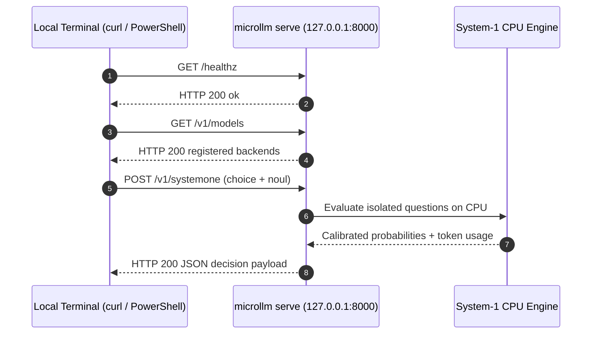

# Tutorial 1: Local Server Quickstart

> **Learning Goal:** Launch an isolated local MicroLLM HTTP server on CPU, verify health and model listings, and
> inspect a typed `POST /v1/systemone` decision response.

> [!WARNING]
> **Isolated Local Sandbox Only:** Run every command in this tutorial on your local development workstation
> (`127.0.0.1`). Never point tutorial payloads or test commands at staging or production servers.

---

## Prerequisites

Make sure your local environment meets these requirements before you start:

- Python `3.10` or newer with `micro-jev` installed in a local virtual environment (for example `.venv`)
- Local loopback port `8000` available on `127.0.0.1`
- Terminal shell (`bash` or `PowerShell`) with `curl` (or `Invoke-RestMethod`)

---

## What You Will Build

By the end of this lesson, you will have:

1. Started a zero-GPU `microllm serve` FastAPI server bound strictly to `127.0.0.1:8000`.
2. Verified server readiness via `GET /healthz` and inspected available backends on `GET /v1/models`.
3. Sent a multi-question `POST /v1/systemone` request combining `choice` and `noul`.
4. Inspected calibrated probabilities, scalar `noul` output, and token usage accounting, then stopped the server.



---

## Step 1: Start the Isolated Local Server

Open your first terminal in the project environment and start the FastAPI server bound to `127.0.0.1`:

```bash
microllm serve --host 127.0.0.1 --port 8000
```

> [!TIP]
> If `microllm` is not on your `PATH`, run `python -m microllm.server serve --host 127.0.0.1 --port 8000` inside your
> virtual environment (or `.\.venv\Scripts\python.exe -m microllm.server serve --host 127.0.0.1 --port 8000`).

Expected output:

```text
INFO:     Started server process [12345]
INFO:     Waiting for application startup.
INFO:     Application startup complete.
INFO:     Uvicorn running on http://127.0.0.1:8000 (Press CTRL+C to quit)
```

Leave this first terminal running while you execute requests from a second terminal.

---

## Step 2: Verify Health and Available Models

Open a second terminal and check the liveness probe on `GET /healthz`:

```bash
curl -s http://127.0.0.1:8000/healthz
```

Expected output:

```json
{"status":"ok","service":"microllm"}
```

Next, inspect the decision backends exposed on `GET /v1/models`:

```bash
curl -s http://127.0.0.1:8000/v1/models
```

Expected output (formatted for readability):

```json
{
  "models": [
    {
      "name": "jev-latest",
      "description": "MicroLLM Dual-Gear Hybrid Cascade (FastEncoder + AnyJev L0 Prefill + RLCD)",
      "release_date": "2026-10-21"
    },
    {
      "name": "microllm-gear1-fast",
      "description": "Gear 1 Single-Pass Non-Autoregressive Encoder with NLI Templating & Per-K Scaling",
      "release_date": "2026-10-21"
    },
    {
      "name": "microllm-gear2-anyjev-l0",
      "description": "Gear 2 AnyJev L0 Circular Rotation Prefill Reader (Position-Bias Free)",
      "release_date": "2026-10-21"
    }
  ]
}
```

---

## Step 3: Send Your First Typed Decision Request

Submit a single `POST /v1/systemone` request containing two independent questions for one support ticket:

- `intent` (`choice`): classifies the ticket into `billing`, `technical`, or `account`.
- `urgent` (`noul`): estimates the binary probability that immediate billing review is required.

```bash
curl -s -X POST http://127.0.0.1:8000/v1/systemone \
  -H "Content-Type: application/json" \
  -d '{
    "model": "jev-latest",
    "state": "My credit card was charged twice for invoice INV-9902.",
    "questions": {
      "intent": {
        "type": "choice",
        "instructions": "Classify the support ticket",
        "criteria": {
          "billing": "Invoice or payment issue",
          "technical": "Bug or outage",
          "account": "Login or MFA issue"
        }
      },
      "urgent": {
        "type": "noul",
        "instructions": "Does this require immediate billing review?"
      }
    }
  }'
```

Expected output (formatted for readability; exact float scores vary slightly by installed backend):

```json
{
  "model": "jev-latest",
  "answers": {
    "intent": {
      "type": "choice",
      "choice": "billing",
      "probabilities": {
        "billing": 0.9948700015736924,
        "technical": 0.0033542263186333043,
        "account": 0.0017757721076742542
      },
      "confidence": 0.9923050023605386
    },
    "urgent": {
      "type": "noul",
      "noul": 0.9930398083254658
    }
  },
  "usage": {
    "input_tokens": 25,
    "output_tokens": 8
  }
}
```

---

## Step 4: Inspect the Calibrated JSON Output

Notice how each field in the JSON response follows the `jevcompat 0.1` contract:

- **`answers.intent.choice`**: selects `"billing"` and returns a probability simplex summing to `1.0` across all
  three candidate keys.
- **`answers.intent.confidence`**: reports calibrated choice confidence in `[0.0, 1.0]`.
- **`answers.urgent.noul`**: returns a single calibrated probability scalar (`0.9930...`) without an unprefixed
  `confidence` field, matching the `jevcompat 0.1` `noul` schema.
- **`usage`**: reports non-negative integer token accounting (`input_tokens` and `output_tokens`).

To continue exploring structured labs on typed primitives, calibration, and invariance proofs, review the
[Engineering & Scientific Syllabus](../SYLLABUS.md).

---

## Step 5: Stop the Server Cleanly

Return to your first terminal and press `Ctrl+C` to shut down Uvicorn cleanly.

Expected output:

```text
INFO:     Shutting down
INFO:     Waiting for application connection.
INFO:     Finished server process [12345]
```

Verify in your second terminal that the local port is closed and no sandbox server remains running:

```bash
curl -sf http://127.0.0.1:8000/healthz || echo "Local sandbox server stopped cleanly."
```

Expected output:

```text
Local sandbox server stopped cleanly.
```

---

## Next Steps

- Continue to [Tutorial 2: Decision Studio and Calibration Lab](02-decision-studio-and-calibration-lab.md)
- Deploy containers and manage ONNX profiles: [How-To Guides](../02-how-to-guides/index.md)
- Inspect HTTP schemas, CLI flags, and exit codes: [Reference](../03-reference/index.md)
- Understand Gear 1, AnyJev $L_0$, and StartLux cascades: [Explanation](../04-explanation/index.md)
