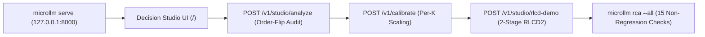

# Tutorial 2: Decision Studio and Calibration Lab

> **Learning Goal:** Explore the local Decision Studio playground, observe zero option-order drift across Gear 1 and
> Gear 2, run live RLCD² calibration experiments, and verify all 15 built-in RCA checks.

> [!WARNING]
> **Isolated Local Sandbox Only:** Run every step in this tutorial against a temporary local server on `127.0.0.1`.
> Never execute diagnostic or training experiments against production traffic.

---

## Prerequisites

Make sure your workstation is ready before you begin:

- Completed [Tutorial 1: Local Server Quickstart](01-local-server-quickstart.md) (`micro-jev` on Python `3.10+`)
- Local port `8000` free on `127.0.0.1`
- A local web browser plus `curl` in a second terminal

---

## What You Will Build

By the end of this lesson, you will have:

1. Opened the built-in FastAPI Decision Studio playground at `http://127.0.0.1:8000/`.
2. Executed a Gear 1, Gear 2, and Cascade diagnostic with live order-flip auditing via `/v1/studio/analyze`.
3. Run Per-K temperature calibration and two-stage RLCD² optimization via `/v1/calibrate` and `/v1/studio/rlcd-demo`.
4. Run `microllm rca --all` to verify all 15 non-regression checks and stopped the sandbox server cleanly.



---

## Step 1: Launch Decision Studio Locally

Start the local MicroLLM server in your first terminal:

```bash
microllm serve --host 127.0.0.1 --port 8000
```

Wait until Uvicorn prints `Application startup complete`, then open `http://127.0.0.1:8000/` in your local browser.

You will see the **MicroLLM — Decision Studio** interface with:

- **Simple Tabs**: `Yes / No Question`, `Single Choice (Pick 1)`, `Multi-Tagging (Select All)`,
  `Rating & Scale (1–4)`, and `Safety & Policy Check`.
- **Advanced & Custom Views**: `Advanced Studio (Multi-Question & JSON)`, `All-in-One Cockpit`,
  `Batch Evaluator`, `RLCD² Lab`, and `Benchmarks & HF Models`.

> [!NOTE]
> If you installed the `gradio` extra (`pip install "micro-jev[gradio]"`), you can also launch the standalone Gradio
> playground on port `7860` with `microllm studio --port 7860`.

---

## Step 2: Run a Side-by-Side Order-Flip Diagnostic

In `Advanced Studio` (or via `POST /v1/studio/analyze`), submit a ticket to compare Gear 1, Gear 2, and the
Dual-Gear Cascade while reversing candidate option order:

```bash
curl -s -X POST http://127.0.0.1:8000/v1/studio/analyze \
  -H "Content-Type: application/json" \
  -d '{
    "state": "My credit card was charged twice for invoice INV-9902.",
    "questions": {
      "intent": {
        "type": "choice",
        "instructions": "Triage ticket",
        "criteria": {
          "billing": "Payment issue",
          "technical": "Bug",
          "account": "Login"
        }
      }
    }
  }'
```

Inspect the `order_flip_audit`, `token_attribution`, and `voc_diagnostics` sections of the JSON response:

```json
{
  "order_flip_audit": {
    "intent": {
      "forward_choice": "billing",
      "reverse_choice": "billing",
      "order_flipped": false,
      "max_probability_drift": 0.0
    }
  },
  "token_attribution": {
    "intent": [
      {"token": "charged", "score": 4.177, "normalized_weight": 1.0},
      {"token": "card", "score": 4.0588, "normalized_weight": 0.9717},
      {"token": "invoice", "score": 3.9844, "normalized_weight": 0.9539}
    ]
  },
  "voc_diagnostics": {
    "intent": {
      "uncertainty_regime": "confident_direct",
      "should_abstain": false,
      "should_escalate_gear2": false,
      "expected_voc_gain": -0.0395,
      "gear1_confidence": 0.9749
    }
  }
}
```

Notice `order_flipped: false` and `max_probability_drift: 0.0`: reversing the option list changes neither the
selected choice nor the AnyJev $L_0$ probability distribution.

---

## Step 3: Run the Calibration and RLCD² Lab Demo

Test Per-K temperature scaling and Split Conformal calibration on synthetic overconfident logits via
`POST /v1/calibrate`:

```bash
curl -s -X POST http://127.0.0.1:8000/v1/calibrate \
  -H "Content-Type: application/json" \
  -d '{"alpha": 0.10}'
```

Expected output (abbreviated to highlight calibration metrics):

```json
{
  "cardinality_k": 4,
  "temperature": 3.9066,
  "fitted_temperature": 3.9066,
  "raw_brier": 0.781,
  "calibrated_brier": 0.616,
  "ece_before": 0.3403,
  "raw_ece": 0.3403,
  "calibrated_ece": 0.0398,
  "conformal_q_hat": 0.8662,
  "clopper_pearson_certification": {
    "threshold": 1.0,
    "coverage": 0.0,
    "empirical_risk": 0.0,
    "upper_risk_bound": 1.0
  }
}
```

Observe how fitted temperature `3.9066` reduces Expected Calibration Error (`raw_ece` to `calibrated_ece`) from
`0.3403` down to `0.0398`.

Now run the live two-stage **RLCD²** training and calibration experiment (also available in the **RLCD² Lab** tab):

```bash
curl -s -X POST http://127.0.0.1:8000/v1/studio/rlcd-demo \
  -H "Content-Type: application/json" \
  -d '{"stage1_steps": 35, "stage2_steps": 25, "use_rlcd2_weights": true, "seed": 42}'
```

Expected `metrics` summary in the JSON response:

```json
{
  "initial_brier": 0.8466,
  "stage1_brier": 0.2177,
  "final_brier": 0.1967,
  "initial_loss": 0.8466,
  "final_stage2_loss": 0.1967,
  "initial_ece": 0.1894,
  "final_ece": 0.1849,
  "initial_accuracy": 0.2375,
  "final_accuracy": 0.9062
}
```

Stage 1 Pathwise Brier calibration and Stage 2 LOO REINFORCE optimization lower the Brier score from `0.8466` to
`0.1967` while lifting accuracy from `23.75%` to `90.62%`.

---

## Step 4: Verify All 15 Non-Regression RCAs

In your second terminal, run the built-in sequential RCA verification runner:

```bash
microllm rca --all
```

Expected output:

```text
# MicroLLM RCA Non-Regression Verification Report

> **Execution Mode**: Sequential (One-by-One) · **Total RCAs Evaluated**: 15

| RCA ID | Title | Status | Accuracy | SLA | Latency p50 | SLA p50 | Non-Regression |
| :--- | :--- | :---: | :---: | :---: | :---: | :---: | :---: |
| **RCA-001** | noul Decision Inversion on Exemption Clauses (unless/exempt) | ✅ PASS | 100.0% | 100.0% | 0.090 ms | 2.00 ms | GUARANTEED |
| **RCA-002** | Residual Order Drift under AnyJev L0 Early Stopping on choice | ✅ PASS | 100.0% | 100.0% | 0.512 ms | 4.00 ms | GUARANTEED |
...
| **RCA-015** | Cumulative Multi-JSON Output & PowerShell Redirection Pitfall | ✅ PASS | 100.0% | 100.0% | 0.018 ms | 1.50 ms | GUARANTEED |

### Overall Summary: 15/15 Passed (100.0%)
```

---

## Step 5: Clean Up the Sandbox Server

Return to your first terminal and press `Ctrl+C` to stop `microllm serve` (and stop `microllm studio` if started).

Verify in your second terminal that port `8000` is closed:

```bash
curl -sf http://127.0.0.1:8000/healthz || echo "Decision Studio server stopped cleanly."
```

Expected output:

```text
Decision Studio server stopped cleanly.
```

---

## Next Steps

- Continue to [Tutorial 3: Guard Middleware Sandbox](03-guard-middleware-sandbox.md)
- Run reproducible benchmark suites in CI or locally: [How-To Guides](../02-how-to-guides/index.md)
- Look up `/v1/*` endpoint schemas and CLI options: [Reference](../03-reference/index.md)
- Read architectural deep dives on calibration and cascades: [Explanation](../04-explanation/index.md)
