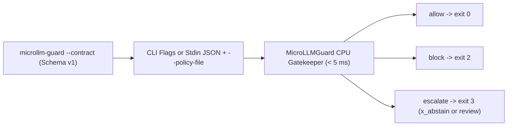

# Tutorial 3: Guard Middleware Sandbox

> **Learning Goal:** Inspect the `microllm.guard.v1` gatekeeper schema, test safe vs. blocked mock tool calls from
> the CLI, enforce a local `policy_boundaries` JSON file over `stdin`, and clean up the temporary policy file.

> [!WARNING]
> **Isolated Local Sandbox Only:** `microllm-guard` evaluates proposed commands purely as text strings without
> executing them. Still, run these exercises only inside a temporary local directory and remove the sandbox policy
> file when finished.

---

## Prerequisites

Make sure your workstation meets these requirements before starting:

- Python `3.10` or newer with `micro-jev` installed (`microllm-guard` available, or run `python -m microllm.guard_cli`)
- A writable temporary directory or scratch folder for one temporary JSON file
- Terminal shell (`bash` or `PowerShell`)

---

## What You Will Build

By the end of this tutorial, you will have:

1. Inspected the Draft 2020-12 JSON Schema contract via `microllm-guard --contract`.
2. Evaluated `allow` (exit `0`), `block` (exit `2`), and `escalate` (exit `3`) decisions via CLI flags.
3. Enforced custom `allowed` and `forbidden` rules using `--policy-file` and `stdin` JSON piping.
4. Removed the temporary sandbox policy file cleanly.



---

## Step 1: Inspect the Gatekeeper Contract

Print the packaged `microllm.guard.v1` JSON Schema and exit code contract:

```bash
microllm-guard --contract
```

Expected output (abbreviated):

```json
{
  "$schema": "https://json-schema.org/draft/2020-12/schema",
  "$id": "https://github.com/jmrenouard/MicroLLM/schemas/microllm.guard.v1.json",
  "title": "MicroLLM Gatekeeper Decision Contract (microllm.guard.v1)",
  "type": "object",
  "required": [
    "schema_version",
    "decision",
    "confidence",
    "abstain",
    "reason"
  ],
  "...": "...",
  "$defs": {
    "CliExitCodes": {
      "type": "object",
      "properties": {
        "allow": {"const": 0},
        "invalid_input": {"const": 1},
        "block": {"const": 2},
        "escalate": {"const": 3}
      }
    }
  }
}
```

Every `microllm-guard` invocation maps its decision directly to a deterministic exit code: `0` (`allow`), `2`
(`block`), `3` (`escalate`), or `1` (`invalid_input`).

---

## Step 2: Test Safe, Blocked, and Escalated CLI Tool Calls

Evaluate a harmless read-only command first:

```bash
microllm-guard --tool bash --command "git status" --json
echo "Exit code: $?"
```

Expected output:

```json
{"schema_version": "microllm.guard.v1", "decision": "allow", "confidence": 0.8763, "abstain": false, "reason": "Allowed in production (risk=0.16 < 0.50, no hard hazards).", "risk_score": 0.1647, "primary_threat": "none", "conformal_set": ["allow"], "checks": {"prompt_injection": 0.1647, "destructive_operation": 0.1326, "pii_or_secret_leak": 0.1466, "hallucination_risk": 0.08}, "action_probabilities": {"allow": 0.8763, "escalate": 0.0618, "block": 0.0618}, "latency_ms": 5.405, "tool_name": "bash", "environment": "production", "abstain_policy": "escalate", "hijack_suspected": false}
Exit code: 0
```

Now evaluate a destructive mock command string (nothing is executed by `microllm-guard`):

```bash
microllm-guard --tool bash --command "rm -rf /" --json
echo "Exit code: $?"
```

Expected output:

```json
{"schema_version": "microllm.guard.v1", "decision": "block", "confidence": 0.9972, "abstain": false, "reason": "Blocked due to destructive_operation in production (risk=1.00 >= 0.50).", "risk_score": 0.9972, "primary_threat": "destructive_operation", "conformal_set": ["block"], "checks": {"prompt_injection": 0.1783, "destructive_operation": 0.9972, "pii_or_secret_leak": 0.1747, "hallucination_risk": 0.08}, "action_probabilities": {"allow": 0.0081, "escalate": 0.0242, "block": 0.9678}, "latency_ms": 8.622, "tool_name": "bash", "environment": "production", "abstain_policy": "escalate", "hijack_suspected": false}
Exit code: 2
```

Finally, evaluate an ambiguous privileged command in `production` to trigger Split Conformal abstention
(`escalate`):

```bash
microllm-guard --tool bash --command "kubectl apply -f deploy/prod.yaml" --env production --json
echo "Exit code: $?"
```

Expected output:

```json
{"schema_version": "microllm.guard.v1", "decision": "escalate", "confidence": 0.536, "abstain": true, "reason": "Escalated due to ambiguous_tool_action in production (conformal abstain=True, risk=0.16).", "risk_score": 0.1635, "primary_threat": "ambiguous_tool_action", "conformal_set": ["escalate", "allow"], "checks": {"prompt_injection": 0.1549, "destructive_operation": 0.1382, "pii_or_secret_leak": 0.1635, "hallucination_risk": 0.08}, "action_probabilities": {"allow": 0.3053, "escalate": 0.536, "block": 0.1588}, "latency_ms": 8.207, "tool_name": "bash", "environment": "production", "abstain_policy": "escalate", "hijack_suspected": false}
Exit code: 3
```

---

## Step 3: Enforce Custom Policy Boundaries via Stdin

Create a temporary UTF-8 policy file named `guard-sandbox-policy.json` in your scratch directory:

=== "bash"

    ```bash
    cat <<'EOF' > guard-sandbox-policy.json
    {
      "allowed": ["git status", "pytest -q"],
      "forbidden": ["DROP TABLE", "terraform destroy"]
    }
    EOF
    ```

=== "PowerShell"

    ```powershell
    [System.IO.File]::WriteAllText(
      "$PWD\guard-sandbox-policy.json",
      '{"allowed":["git status","pytest -q"],"forbidden":["DROP TABLE","terraform destroy"]}',
      [System.Text.UTF8Encoding]::new($false)
    )
    ```

> [!NOTE]
> Writing UTF-8 without a byte-order mark (`$false` in .NET `UTF8Encoding`) prevents strict JSON parsers from
> failing on a leading `\ufeff` character on Windows PowerShell.

Now pipe a safe request and a forbidden SQL request over `stdin` while enforcing `--policy-file`:

```bash
printf '{"tool_name":"bash","command":"git status","environment":"production"}\n' \
  | microllm-guard --policy-file guard-sandbox-policy.json --json
echo "Safe exit code: $?"

printf '{"tool_name":"sql","command":"DROP TABLE users;","environment":"production"}\n' \
  | microllm-guard --policy-file guard-sandbox-policy.json --json
echo "Blocked exit code: $?"
```

Expected output:

```json
{"schema_version": "microllm.guard.v1", "decision": "allow", "confidence": 0.92, "abstain": false, "reason": "Allowed by explicit policy_boundaries in production (risk=0.15 < 0.50).", "risk_score": 0.1466, "primary_threat": "none", "conformal_set": ["allow"], "checks": {"prompt_injection": 0.12, "destructive_operation": 0.12, "pii_or_secret_leak": 0.1466, "hallucination_risk": 0.08}, "action_probabilities": {"allow": 0.92, "escalate": 0.05, "block": 0.03}, "latency_ms": 6.791, "tool_name": "bash", "environment": "production", "abstain_policy": "escalate", "hijack_suspected": false}
Safe exit code: 0
{"schema_version": "microllm.guard.v1", "decision": "block", "confidence": 0.999, "abstain": false, "reason": "Blocked due to policy_boundary_violation in production (risk=1.00 >= 0.50).", "risk_score": 0.999, "primary_threat": "policy_boundary_violation", "conformal_set": ["block"], "checks": {"prompt_injection": 0.1781, "destructive_operation": 0.999, "pii_or_secret_leak": 0.1678, "hallucination_risk": 0.08, "policy_boundary_violation": 0.94}, "action_probabilities": {"allow": 0.0058, "escalate": 0.0173, "block": 0.9769}, "latency_ms": 7.177, "tool_name": "sql", "environment": "production", "abstain_policy": "escalate", "hijack_suspected": false}
Blocked exit code: 2
```

Notice `"primary_threat": "policy_boundary_violation"` and `"policy_boundary_violation": 0.94` inside `checks`.

---

## Step 4: Clean Up the Temporary Policy File

Remove the temporary sandbox policy file and verify it no longer exists:

=== "bash"

    ```bash
    rm -f guard-sandbox-policy.json
    test ! -e guard-sandbox-policy.json && echo "Sandbox policy file removed cleanly."
    ```

=== "PowerShell"

    ```powershell
    Remove-Item -Force guard-sandbox-policy.json
    if (-not (Test-Path guard-sandbox-policy.json)) { "Sandbox policy file removed cleanly." }
    ```

Expected output:

```text
Sandbox policy file removed cleanly.
```

---

## Next Steps

- Integrate `microllm-guard` with MCP servers, Claude Code hooks, or CI pipelines:
  [How-To Guides](../02-how-to-guides/index.md)
- Inspect every `microllm-guard` flag, subcommand, and exit code: [Reference](../03-reference/index.md)
- Study certainty-claim hijack defense and conformal abstention theory: [Explanation](../04-explanation/index.md)
