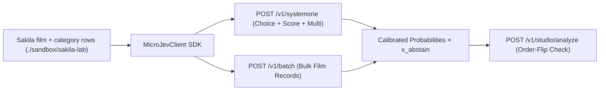

# Tutorial 4: Sakila Film Classification and Tagging

> **Learning Goal:** Classify and tag real film rows from the `jmrenouard/test_db` Sakila schema using
> `MicroJevClient` (`Choice`, `Score`, and `Multi`), inspect calibrated probabilities and Split Conformal `x_abstain`,
> and stop the local server cleanly.

> [!WARNING]
> **Isolated Local Sandbox Only:** Run every command in this tutorial inside a temporary local directory
> (`./sandbox/sakila-lab`) against `127.0.0.1:8000`. Never point tutorial scripts at staging or production APIs.

---

## Prerequisites

Verify these local requirements before you begin:

- Completed [Tutorial 1: Local Server Quickstart](01-local-server-quickstart.md) (`micro-jev` on Python `3.10+`)
- Free local TCP port `8000` on `127.0.0.1`
- Optional `git` and MariaDB/MySQL if you load the full SQL dump from
  [`jmrenouard/test_db`](https://github.com/jmrenouard/test_db) (`sakila/sakila-mv-schema.sql` and
  `sakila/sakila-mv-data.sql`)

---

## What You Will Build

By the end of this lesson, you will have:

1. Created an isolated `./sandbox/sakila-lab` folder modeled on the `test_db` Sakila `film` and `category` tables.
2. Started `microllm serve` on `127.0.0.1:8000` in a first terminal and verified `/healthz`.
3. Executed a `MicroJevClient` Python script calling `client.ask(...)` with `Choice`, `Score`, and `Multi` on real
   row `1` (`ACADEMY DINOSAUR`).
4. Inspected calibrated probabilities, ordinal scores, multi-label selections, and `x_abstain` via
   `POST /v1/studio/analyze` and `client.batch(...)`, then cleaned up the sandbox.



---

## Step 1: Prepare Your Isolated Sakila Sandbox

Create a dedicated local directory for this lesson:

=== "bash"

    ```bash
    mkdir -p ./sandbox/sakila-lab
    cd ./sandbox/sakila-lab
    ```

=== "PowerShell"

    ```powershell
    New-Item -ItemType Directory -Force -Path ./sandbox/sakila-lab | Out-Null
    Set-Location ./sandbox/sakila-lab
    ```

In [`jmrenouard/test_db`](https://github.com/jmrenouard/test_db), the Sakila schema lives in
`sakila/sakila-mv-schema.sql` and seed records live in `sakila/sakila-mv-data.sql`. Key columns used for decision
routing include:

- **`film`**: `film_id`, `title`, `description`, `release_year`, `rental_rate`, `rating`
  (`ENUM('G','PG','PG-13','R','NC-17')`), and `special_features`
  (`SET('Trailers','Commentaries','Deleted Scenes','Behind the Scenes')`).
- **`category`**: `category_id` and `name` (`Action`, `Animation`, `Children`, `Classics`, `Comedy`, `Documentary`,
  `Drama`, `Family`, `Foreign`, `Games`, `Horror`, `Music`, `New`, `Sci-Fi`, `Sports`, `Travel`), linked through
  `film_category`.

Optional: clone `test_db` into `./sandbox/test_db` and inspect the exact SQL insert for `film_id = 1`:

```bash
git clone --depth 1 https://github.com/jmrenouard/test_db.git ../test_db
grep -n "ACADEMY DINOSAUR" ../test_db/sakila/sakila-mv-data.sql
```

You will observe this exact Sakila row in `sakila/sakila-mv-data.sql`:

```sql
INSERT INTO film VALUES (1,'ACADEMY DINOSAUR','A Epic Drama of a Feminist And a Mad Scientist who must Battle a Teacher in The Canadian Rockies',2006,1,NULL,6,'0.99',86,'20.99','PG','Deleted Scenes,Behind the Scenes','2006-02-15 05:03:42');
```

---

## Step 2: Start `microllm serve` in Terminal 1

In your first terminal, start the CPU System-1 server bound to `127.0.0.1:8000`:

```bash
microllm serve --host 127.0.0.1 --port 8000
```

> [!TIP]
> If `microllm` is not on your shell `PATH`, run `python -m microllm.server serve --host 127.0.0.1 --port 8000`
> inside your project virtual environment.

In your second terminal (inside `./sandbox/sakila-lab`), verify liveness:

```bash
curl -s http://127.0.0.1:8000/healthz
```

Expected output:

```json
{"status":"ok","service":"microllm"}
```

---

## Step 3: Classify and Tag `ACADEMY DINOSAUR` with `MicroJevClient`

Create `./sandbox/sakila-lab/classify_sakila.py` with the typed Python SDK (`MicroJevClient`, `Choice`, `Score`, and
`Multi`):

```python
import httpx
from microllm import Choice, MicroJevClient, Multi, Score

client = MicroJevClient(base_url="http://127.0.0.1:8000")

film_row = {
    "film_id": 1,
    "title": "ACADEMY DINOSAUR",
    "description": (
        "A Epic Drama of a Feminist And a Mad Scientist who must Battle "
        "a Teacher in The Canadian Rockies"
    ),
    "release_year": 2006,
    "rental_rate": 0.99,
    "rating": "PG",
    "special_features": "Deleted Scenes,Behind the Scenes",
}

questions = {
    "genre": Choice(
        options={
            "Action": "Explosive combat, military raids, espionage stunts, and high-speed car chases",
            "Comedy": "Lighthearted comedy, slapstick humor, satire, and comic misunderstandings",
            "Documentary": "Documentary narrative, non-fiction investigation, historical or scientific report",
            "Drama": "Emotional interpersonal drama, personal struggle, and character conflict",
            "Sci-Fi": "Mad scientist experiment, futuristic space travel, robots, and speculative science",
        },
        instructions="Classify the Sakila film description into the primary genre category.",
    ),
    "rating_intensity": Score(
        levels=[
            "G: General audiences, family-friendly and mild",
            "PG: Parental guidance suggested, mild thematic conflict",
            "PG-13: Intense drama or sci-fi peril for teens",
            "R: Mature violence, strong conflict, or adult themes",
            "NC-17: Explicit adult-only content",
        ],
        instructions="Rate the content intensity on the MPAA 5-level ordinal scale.",
    ),
    "content_tags": Multi(
        options={
            "mad_scientist": "Features a scientist or laboratory experiment",
            "wilderness_survival": "Set in mountains, Rockies, or outdoor terrain",
            "behind_the_scenes": "Includes Behind the Scenes or Deleted Scenes bonus features",
            "musical_concert": "Live concert tour, singing choir, and Broadway stage dancing",
        },
        instructions="Select all applicable content and bonus-feature tags.",
        threshold=0.65,
    ),
}

answers = client.ask(state=film_row, questions=questions)
print("Genre:", answers["genre"].value, f"(confidence={answers['genre'].confidence:.4f})")
print("Genre probs:", {k: round(v, 4) for k, v in answers["genre"].probabilities.items()})
print("Rating score:", round(answers["rating_intensity"].score, 4), "->", answers["rating_intensity"].value)
print("Content tags:", answers["content_tags"].labels)
print("Tag probs:", {k: round(v, 4) for k, v in answers["content_tags"].probabilities.items()})

audit = httpx.post(
    "http://127.0.0.1:8000/v1/studio/analyze",
    json={
        "state": film_row,
        "questions": {qid: q.to_payload() for qid, q in questions.items()},
    },
    timeout=30.0,
).json()
genre_meta = audit["cascade"]["genre"]["meta"]
print("Genre x_abstain:", genre_meta["x_abstain"], "conformal_set:", genre_meta["x_conformal_set"])
```

Run the script from Terminal 2:

```bash
python classify_sakila.py
```

Expected output:

```text
Genre: Sci-Fi (confidence=0.2583)
Genre probs: {'Action': 0.1075, 'Comedy': 0.145, 'Documentary': 0.0992, 'Drama': 0.2417, 'Sci-Fi': 0.4066}
Rating score: 1.4786 -> PG: Parental guidance suggested, mild thematic conflict
Content tags: ['mad_scientist', 'wilderness_survival', 'behind_the_scenes']
Tag probs: {'mad_scientist': 0.8028, 'wilderness_survival': 0.8264, 'behind_the_scenes': 0.9637, 'musical_concert': 0.5539}
Genre x_abstain: True conformal_set: ['Sci-Fi', 'Drama', 'Comedy', 'Action', 'Documentary']
```

---

## Step 4: Inspect Calibrated Probabilities, `x_abstain`, and Batch Throughput

Review what each MicroLLM primitive produced on `ACADEMY DINOSAUR`:

1. **`Choice` (`genre`)**: `Sci-Fi` receives `0.4066` and `Drama` receives `0.2417`, yielding `confidence = 0.2583`.
   Because the Sakila blurb blends `"Epic Drama"` with `"Mad Scientist"`, `/v1/studio/analyze` reports
   `x_abstain: True` and keeps all competing options inside `x_conformal_set`.
2. **`Score` (`rating_intensity`)**: The expected ordinal score `1.4786` peaks at index `'1'`
   (`PG: Parental guidance suggested, mild thematic conflict`), matching the SQL `rating = 'PG'` column.
3. **`Multi` (`content_tags`, `threshold=0.65`)**: Independent calibrated sigmoids select `mad_scientist` (`0.8028`),
   `wilderness_survival` (`0.8264`), and `behind_the_scenes` (`0.9637`), while rejecting `musical_concert` (`0.5539`).

Next, verify `client.batch(...)` (`POST /v1/batch`) across two Sakila rows (`ACADEMY DINOSAUR` and row `5`,
`AFRICAN EGG`) by appending a small batch check or running an inline command:

```python
batch_res = client.batch(
    items=[
        film_row,
        {
            "film_id": 5,
            "title": "AFRICAN EGG",
            "description": (
                "A Fast-Paced Documentary of a Pastry Chef And a Dentist who must "
                "Pursue a Forensic Psychologist in The Gulf of Mexico"
            ),
            "release_year": 2006,
            "rental_rate": 2.99,
            "rating": "G",
            "special_features": "Deleted Scenes",
        },
    ],
    questions={"genre": questions["genre"]},
)
print("Summary:", batch_res["summary"])
for row in batch_res["results"]:
    ans = row["answers"]["genre"]
    print(f"film_id={row['state']['film_id']} choice={ans['choice']} abstain={row['abstain']}")
```

Expected output (latencies and cache counters vary slightly by CPU load and prior server calls):

```text
Summary: {'total_items': 2, 'abstained_count': 2, 'total_latency_ms': 2.555, 'avg_latency_ms': 1.278, 'p50_latency_ms': 1.091, 'p95_latency_ms': 1.092, 'verdict_mq_cache': {'hits': 3, 'misses': 2, 'cached_states': 2, 'hit_rate': 0.6}}
film_id=1 choice=Sci-Fi abstain=True
film_id=5 choice=Documentary abstain=True
```

Notice how `POST /v1/batch` exposes `abstain` per row and `summary.abstained_count` directly without calling
`/v1/studio/analyze`.

---

## Step 5: Stop the Server and Clean Up the Sandbox

Return to Terminal 1 and press `Ctrl+C` to stop `microllm serve`. Then verify the port is closed and remove the
temporary sandbox folder from Terminal 2:

=== "bash"

    ```bash
    curl -sf http://127.0.0.1:8000/healthz || echo "Local server stopped cleanly."
    cd ../..
    rm -rf ./sandbox/sakila-lab ./sandbox/test_db
    ```

=== "PowerShell"

    ```powershell
    try { Invoke-RestMethod http://127.0.0.1:8000/healthz | Out-Null } catch { "Local server stopped cleanly." }
    Set-Location ../..
    Remove-Item -Recurse -Force ./sandbox/sakila-lab, ./sandbox/test_db -ErrorAction SilentlyContinue
    ```

Expected output:

```text
Local server stopped cleanly.
```

---

## Next Steps

- Continue to [Tutorial 5: Sirene French Business Enrichment Lab](05-sirene-french-business-enrichment-lab.md)
- Run bulk table classification in production pipelines:
  [Batch Classify Database Tables](../02-how-to-guides/operations/batch-classify-database-tables.md)
  ([All How-To Guides](../02-how-to-guides/index.md))
- Inspect `POST /v1/systemone` and `POST /v1/batch` schemas: [Reference](../03-reference/index.md)
- Read how AnyJev $L_0$ and Split Conformal abstention work:
  [Dual-Gear System-1 Topology](../04-explanation/architecture-overview/dual-gear-system1-topology.md)
  ([All Explanations](../04-explanation/index.md))
