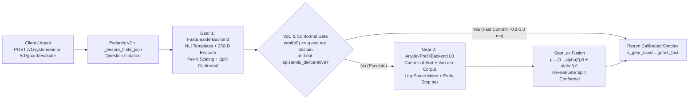
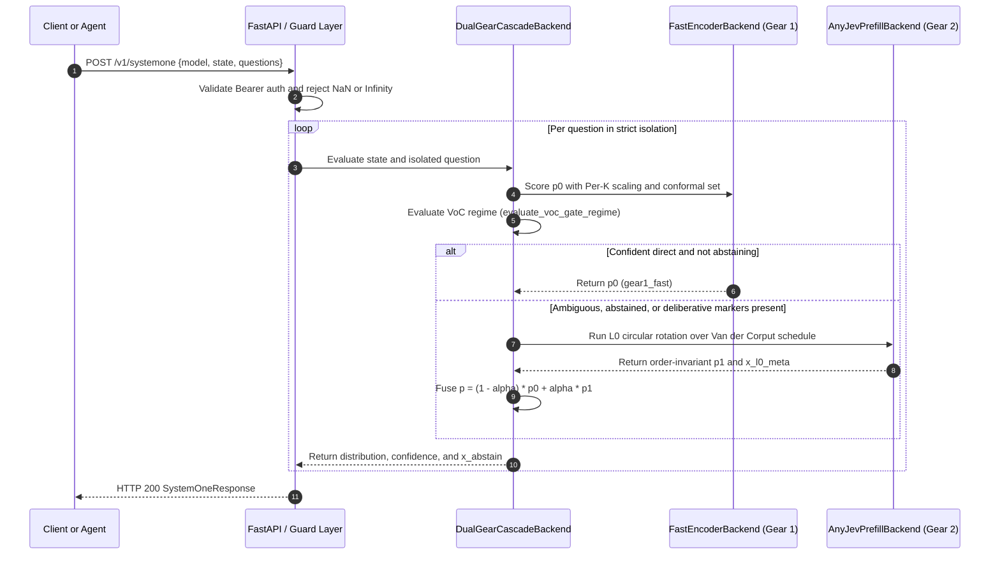
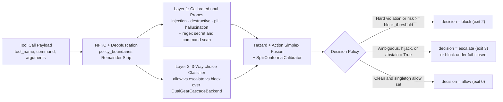

# Dual-Gear System-1 Architecture Topology

MicroLLM decouples structured classification from autoregressive token generation (`System 2`). Instead of
sampling sequential output tokens and parsing fragile JSON strings, MicroLLM evaluates a `state` and named
`questions` in single-pass CPU primitives (`noul`, `choice`, `score`, `multi`) under the `jevcompat 0.1` contract.

## End-to-End Decision Topology

Incoming requests enter through the FastAPI transport layer
([`src/microllm/server.py`](../../../src/microllm/server.py)) or the in-process SDK and gatekeeper modules.
Every question inside a multi-question `POST /v1/systemone` payload executes in complete isolation via
`_evaluate_isolated_question`, guaranteeing bit-identical outputs regardless of question key names, batch size,
or question order.

## Request Execution Sequence

The sequence below traces how `DualGearCascadeBackend`
([`src/microllm/backends/cascade.py`](../../../src/microllm/backends/cascade.py)) coordinates fast-path
resolution, deliberative escalation, and conformal abstention signaling.

## Gear 1: Fast Non-Autoregressive Encoder (`FastEncoderBackend`)

Gear 1 ([`src/microllm/backends/fast_encoder.py`](../../../src/microllm/backends/fast_encoder.py)) is optimized
for sub-millisecond deterministic throughput on standard CPUs (`p50 = 0.076 ms` to `0.367 ms` across core
benchmarks):

1. **Context Guard and Hypothesis Templating**: Truncates verbose premises at `512` words via
   `truncate_to_context_budget` and formats `(option_name, description)` pairs into complete NLI sentences
   (`"It is {name}: {desc}."` and localized FR/ES/PT equivalents) via `format_nli_hypothesis`.
2. **256-D Deterministic CPU Representation or Pluggable Scorer**: By default, `embed_text_deterministic`
   ([`src/microllm/backends/base.py`](../../../src/microllm/backends/base.py)) partitions vectors into `16`
   multilingual concept-cluster dimensions (`0..15`) and `240` signed `BLAKE2b` word and character 3-gram hash
   slots (`16..255`), backed by `functools.lru_cache` memoization and clause-salient max-pooling
   (`0.25 * global + 0.75 * max_clause`). External HuggingFace or INT8 ONNX cross-encoders plug into the same
   `logit_scorer` interface.
3. **Adversarial Rubric & Hijack Defenses**: Detects when an option key semantically conflicts with another
   option's definition (`_detect_rubric_conflict`) to enforce definition-dominant weighting, triggers
   multi-template consensus when the top-2 logit margin is `<= 0.12`, and flags certainty-claim hijack markers
   via `detect_evidence_competition_hijack`.
4. **High-Cardinality Routing (`K > 25`)**: Calls `run_hierarchical_tournament`
   ([`src/microllm/confidence.py`](../../../src/microllm/confidence.py)) to partition `26..255` candidates into
   chunks of `25` options and advance the top `3` finalists per chunk to a playoff round without attention dilution.
5. **Calibration and Conformal Wrapper**: Applies `PerKTemperatureScaler` across option counts and computes
   `x_conformal_set` plus `x_abstain` via `SplitConformalCalibrator`.

## Gear 2: AnyJev $L_0$ Prefill Reader (`AnyJevPrefillBackend`)

Gear 2 ([`src/microllm/backends/prefill_llm.py`](../../../src/microllm/backends/prefill_llm.py)) implements the
training-free readout mechanisms from Nokia Applied Research's *AnyJev Technical Report* (`arXiv:2610.00831`):

- **Canonical Input Stabilization**: Sorts unordered `choice`, `noul`, and `multi` option keys lexicographically
  (`canonicalize_order=True`) before rotation, while preserving natural `0..K-1` rank order for ordinal `score`.
- **Circular Rotation Readout (`l0_circular_rotation_readout`)**: Rotates option slot assignments in
  binary-reflected Van der Corput order (`van_der_corput_order`) and averages slot log-probabilities in log-space,
  algebraically eliminating additive slot biases and achieving `0.000000` order-flip drift.
- **Early Stopping and Answer Mass Gate**: Halts rotation after `min_passes = 2` whenever the top-2 log-odds
  margin reaches $\tau$ (cutting average rotations by `78.3%`), emits `answer_mass_gate_passed` (`m >= 0.15`),
  and optionally applies streaming EMA debiasing (`OnlinePriorTracker`, $\alpha = 0.75$).
- **Local SLM Prefill Connectors**: Accepts live OpenAI-compatible logprob endpoints (`vLLM`, `Ollama`) or
  `llama.cpp` servers via `MICROLLM_SLM_BASE_URL` while falling back cleanly to deterministic semantic slot
  scoring when offline.

## StartLux Read-or-Think Cascade (`DualGearCascadeBackend`)

The cascade combines Gear 1 speed with Gear 2 position-invariant reasoning through a Value-of-Computation (VoC)
and conformal gate:

- **Fast Auto-Commit**: Gear 1 returns `p0` directly when `confidence(p0) >= gate_threshold` (default `0.75`),
  `x_abstain` is `False`, and `evaluate_voc_gate_regime` does not flag `epistemic_deliberative` markers (such as
  `"unless"`, `"exempt"`, `"waiver"`, `"override"`).
- **Escalation and Convex Fusion**: When uncertain, abstaining, or deliberative, Gear 2 computes `p1` and the
  cascade merges both distributions:

$$
p_{\text{fused}} = (1 - \alpha)\, p_0 + \alpha\, p_1
$$

By default $\alpha = 0.75$, or `compute_adaptive_alpha` adjusts $\alpha(x) \in [0.15, 0.95]$ using Gear 2
versus Gear 1 confidence delta and answer mass. Split Conformal sets are recomputed over $p_{\text{fused}}$ before
emitting the response.

## Guardrail and Gatekeeper Dataflow (`MicroLLMGuard`)

MicroLLM applies the Dual-Gear System-1 architecture to AI agent tool-call safety through `POST /v1/guardrail`
(`evaluate_guardrail_in_process`) and the `microllm.guard.v1` gatekeeper engine
([`src/microllm/guard.py`](../../../src/microllm/guard.py)):

This two-layer separation prevents benign CLI flags from saturating prompt-injection detectors while ensuring that
privileged mutations (`kubectl apply`, `terraform`, schema changes) and gray-zone inputs escalate deterministically
instead of passing silently.

## Related Reference and Operational Guides

- Configuration parameters, defaults, ports, and model profiles:
  [Environment and Model Profiles Reference](../../03-reference/configuration/environment-and-model-profiles.md)
- Production troubleshooting for abstention spikes or cascade latency drift:
  [Abstention & Latency Runbook](../../02-how-to-guides/incident-response/remediate-abstention-or-latency-spike.md)
- Architectural trade-off rationale:
  [ADR-001: Dual-Gear Conformal Cascade](../design-decisions/adr-001-dual-gear-conformal-cascade.md)
- Calibration and $L_0$ proofs:
  [Calibration and Order Invariance Deep Dive](../deep-dives/calibration-and-order-invariance.md)
