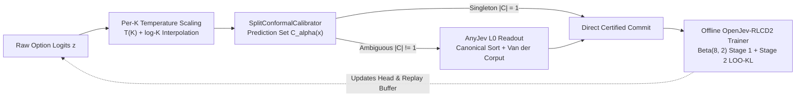

# Calibration, Conformal Abstention, and Order Invariance Deep Dive

MicroLLM's reliability relies on four coupled mathematical mechanisms implemented across
[`src/microllm/calibration.py`](../../../src/microllm/calibration.py),
[`src/microllm/backends/prefill_llm.py`](../../../src/microllm/backends/prefill_llm.py), and
[`src/microllm/rlcd.py`](../../../src/microllm/rlcd.py). Each mechanism addresses a structural failure mode observed
in uncalibrated generative System-2 decision pipelines.

## 1. Per-$K$ Temperature Scaling (`PerKTemperatureScaler`)

### Why One Global Temperature Fails Across Cardinalities

A single scalar temperature $T$ fitted on binary (`K = 2`) tasks systematically miscalibrates multi-way (`K = 10` or
`K = 77`) tasks. As option count $K$ grows, raw logit margins compress toward the noise floor while softmax entropy
grows logarithmically.

`PerKTemperatureScaler` solves this by fitting a dedicated temperature $T_K \in [0.05, 10.0]$ for each observed
cardinality $K$ via bounded optimization (`scipy.optimize.minimize_scalar`) against a combined proper-scoring
objective:

$$
\begin{aligned}
T_K^* = \arg\min_{T \in [0.05, 10.0]} \Big(
  & \text{NLL}\!\left(\text{softmax}(z / T),\, y\right) \\
  & + 0.5 \cdot \text{Brier}\!\left(\text{softmax}(z / T),\, y\right)
\Big)
\end{aligned}
$$

Mixing negative log-likelihood with `0.5 * Brier` penalizes extreme overconfident mistakes without allowing
calibration loss to drift far from probability mass alignment.

### Log-$K$ Interpolation and Vector Scaling

When a runtime request supplies an unseen option count $K$ bounded between two calibrated cardinalities
$K_{\text{low}} < K < K_{\text{high}}$, `PerKTemperatureScaler.get_temperature` interpolates linearly in $\ln K$
rather than raw $K$:

$$
\begin{aligned}
T(K) &= (1 - \rho)\, T_{K_{\text{low}}} + \rho\, T_{K_{\text{high}}} \\
\rho &= \frac{\ln K - \ln K_{\text{low}}}{\ln K_{\text{high}} - \ln K_{\text{low}}}
\end{aligned}
$$

In Gear 1 (`FastEncoderBackend`), pre-populated defaults span `{2: 0.75, 3: 0.80, 4: 0.85, 5: 0.88, 10: 0.95}`
(`default_temperature = 0.85`), clamping below the smallest calibrated $K$ or above the largest calibrated $K$. When
class-specific bias persists despite scalar scaling, `VectorScalingCalibrator` fits $L_2$-regularized diagonal
parameters $\mathbf{a}, \mathbf{b} \in \mathbb{R}^K$ (`z_cal = a * z + b`) via BFGS.

## 2. Split Conformal Abstention Sets and Clopper-Pearson Risk Bounds

### Separating Tie Uncertainty from Unknown-Domain Ignorance

Raw softmax probabilities sum to `1.0` even on out-of-distribution inputs, creating an epistemic blind spot
(*Sys1Cal-v1*, `arXiv:2609.35342`). `SplitConformalCalibrator` translates calibrated probabilities into finite-sample
coverage sets without parametric assumptions beyond exchangeability.

Given $N$ held-out calibration pairs $\{(x_i, y_i)\}_{i=1}^N$, the calibrator computes non-conformity scores
$s_i = 1 - p(y_i \mid x_i)$ and selects the finite-sample quantile:

$$
\hat{q}_{1-\alpha} = \text{Quantile}_{\text{higher}}\!\left(
  \{s_i\}_{i=1}^N;\, \min\!\left(1,\, \frac{\lceil (N + 1)(1 - \alpha) \rceil}{N}\right)
\right)
$$

At inference time, a prediction set includes every candidate whose residual error falls within $\hat{q}_{1-\alpha}$:

$$
C_\alpha(x) = \left\{ k \in \{1, \dots, K\} : p_k \ge 1 - \hat{q}_{1-\alpha} \right\}
$$

If no option meets the threshold, `predict_set` falls back to the highest-probability label as the returned set
element. Downstream safety decisions hinge on the abstention indicator:

$$
\text{abstain}(x) = \big(|C_\alpha(x)| \neq 1\big)
$$

- **Singleton Set ($|C_\alpha(x)| = 1$)**: Only one candidate remains plausible at risk level $\alpha$ (default `0.10`
  for `90%` target coverage); the fast path commits safely.
- **Multi-Candidate Set ($|C_\alpha(x)| > 1$)**: Multiple candidates fall inside the conformal tolerance band; the
  cascade escalates to Gear 2 or raises `x_abstain = True`.

For imbalanced multi-class workloads, `fit_mondrian` and `predict_set_mondrian` compute class-conditional quantiles
$\hat{q}_{1-\alpha}^{(k)}$ per class $k$ (falling back to global $\hat{q}_{1-\alpha}$ when a class has fewer than `3`
calibration samples).

### Clopper-Pearson Selective Risk Certification

While conformal prediction guarantees marginal label coverage, production SLA gates often require bounding error rate
conditioned on acceptance ($P(\hat{Y} \neq Y \mid \text{conf}(X) \ge \tau) \le r_{\text{target}}$).
`clopper_pearson_threshold` sweeps candidate confidence cutoffs $\tau$ and computes the exact one-sided binomial
upper confidence bound at significance $\delta$:

$$
U(e, n_{\text{acc}}, \delta) = \text{Beta}^{-1}\!\left(1 - \delta;\, e + 1,\, n_{\text{acc}} - e\right)
$$

It returns the lowest confidence threshold $\tau$ where $U(e, n_{\text{acc}}, \delta) \le r_{\text{target}}$,
certifying selective accuracy with probability at least $1 - \delta$.

## 3. Van der Corput Circular Rotation Bias Cancellation (AnyJev $L_0$)

### Algebraic Cancellation of Slot Bias in Log-Space

Causal language models and slot-indexed prompts exhibit strong primacy and recency preferences. Following *AnyJev*
Theorem 1 (`arXiv:2610.00831`), suppose pass $t \in \{0, \dots, K-1\}$ places option $i$ at prompt slot
$j = (i - t) \bmod K$ and produces log-probabilities with additive slot bias $b_j$:

$$
\log q_t(i) = s_i + b_{(i - t) \bmod K} - \log Z_t
$$

Averaging the unshuffled option log-probabilities across all $K$ circular rotations produces:

$$
\bar{z}_i = \frac{1}{K}\sum_{t=0}^{K-1} \log q_t(i)
  = s_i + \frac{1}{K}\sum_{j=0}^{K-1} b_j - \frac{1}{K}\sum_{t=0}^{K-1} \log Z_t
$$

Because $\bar{b} = \frac{1}{K}\sum_{j=0}^{K-1} b_j$ and $\overline{\log Z} = \frac{1}{K}\sum_{t=0}^{K-1} \log Z_t$
do not depend on option index $i$, applying $\text{softmax}(\bar{z})$ cancels every slot bias term identically:

$$
p_i^{(L_0)} = \frac{\exp(\bar{z}_i)}{\sum_{k=0}^{K-1} \exp(\bar{z}_k)} = \frac{\exp(s_i)}{\sum_{k=0}^{K-1} \exp(s_k)}
$$

### Van der Corput Schedule, Dynamic $\tau$, and Canonical Sorting

Running all $K$ rotations scales linearly with $K$, creating unnecessary overhead when $K = 20$ and one candidate
dominates. Sequential shifts ($t = 0, 1, 2$) keep early-stop prefixes clustered in adjacent slots, leaving bias
unbalanced. `van_der_corput_order(K)` avoids this by visiting shifts in binary-reflected order:

$$
\text{van\_der\_corput\_order}(K) = \left[
  0,\, \lfloor K/2 \rfloor,\, \lfloor K/4 \rfloor,\, \lfloor 3K/4 \rfloor,\, \dots
\right]
$$

Every prefix maximally separates option positions (first placing options at antipodal slots). After `min_passes = 2`,
`l0_circular_rotation_readout` stops as soon as the running top-2 log-odds margin satisfies
$\mu(\bar{z}) = \bar{z}_{(1)} - \bar{z}_{(2)} \ge \tau$, where `compute_dynamic_tau` scales $\tau$ logarithmically
with $K$ and risk level $\alpha$:

$$
\tau(K, \alpha) = \tau_{\text{base}}
  \cdot \left(1 + 0.12 \ln\!\left(\frac{K}{2}\right)\right)
  \cdot \sqrt{\frac{\ln(1 / \alpha)}{\ln 20}}
$$

Early stopping creates a subtle trap: if a caller permutes input options, starting at shift `0` on two different
caller orders visits different early-stop subsets ($T < K$). `AnyJevPrefillBackend` closes this gap (`RCA-002`) by
sorting unordered `choice`, `noul`, and `multi` keys canonically (`canonicalize_order=True`) prior to rotation and
restoring caller order afterward, achieving `0.000000` order-flip rate and `0.000000` drift even under early
stopping. Ordinal `score` questions preserve natural level order `0..K-1`.

Two guards complement $L_0$: `compute_answer_mass` checks that valid option tokens capture sufficient vocabulary
mass ($m(s, \pi) \ge 0.15$), and `OnlinePriorTracker` (`momentum = 0.05`, `alpha = 0.75`) mitigates class-prior skew
via $p_i^{\text{dbs}} \propto p_i / \hat{q}_i^\alpha$.

## 4. OpenJev-RLCD and $\text{RLCD}^2$ `Beta(8, 2)` Weighting

### Why Group-Mean Scoring Corrupts Calibration (Proposition 1)

Training a decision head across multiple sampled latent rationales $r^{(1)}, \dots, r^{(M)}$ creates a design pitfall
when rewards are computed on the group-averaged prediction $\bar{p} = \mathbb{E}_r[u(r)]$. *OpenJev-RLCD* Proposition 1
(`arXiv:2609.38850`), verified directly by `group_mean_variance_identity` in
[`src/microllm/rlcd.py`](../../../src/microllm/rlcd.py), establishes the exact identity for the shifted Brier rule
$J(u, q) = 2 u^\top q - \|u\|_2^2$:

$$
J\!\left(\mathbb{E}_r[u(r)],\, q\right)
  = \mathbb{E}_r\!\big[J(u(r),\, q)\big]
  + \mathbb{E}_r\!\left[\|u(r) - \bar{p}\|_2^2\right]
$$

Scoring the group mean adds an artificial variance bonus $\mathbb{E}_r[\|u(r) - \bar{p}\|_2^2] \ge 0$ that rewards
arbitrary disagreement across rationales rather than truthful calibrated probabilities. MicroLLM therefore scores
each sampled rationale individually and trains via Algorithm 1 (*Calibrate, then Reinforce*):

1. **Stage 1 (Pathwise Readout Calibration)**: Optimizes readout weights directly against the differentiable Brier
   loss $B(u, y) = \|u - e_y\|_2^2$ via analytical softmax Jacobian $\nabla_z L_1 = u \odot (g_u - u^\top g_u)$, then
   freezes the Stage-1 anchor $\theta_1$.
2. **Stage 2 (KL-Anchored Leave-One-Out REINFORCE)**: Samples $M = 4$ rollouts around the policy mean, penalizes drift
   from the Stage-1 anchor ($\beta = 0.04$), and subtracts the unbiased Leave-One-Out baseline
   (`compute_leave_one_out_kl_advantages`, scaled by `reinforce_weight_c = 0.30`):

$$
\begin{aligned}
\tilde{R}_i &= R_i - \beta \left(
  \log \pi_\theta(r^{(i)} \mid x) - \log \pi_{\theta_1}(r^{(i)} \mid x)
\right) \\
A_i &= \frac{1}{M}\left(
  \tilde{R}_i - \frac{1}{M - 1}\sum_{j \neq i} \tilde{R}_j
\right)
\end{aligned}
$$

Full $R^M \times K$ enumeration in `verify_tabular_rlcd_unbiased_gradient` confirms exact unbiased policy and readout
gradients to `< 1e-12` error.

### Why $\text{RLCD}^2$ Applies `Beta(8, 2)` Decision Weighting

Uniform Brier loss treats errors equally whether predicted confidence $c = \max_k u_k$ sits near `0.35` (where the
cascade escalates anyway) or near `0.90` (where Gear 1 auto-commits without supervision). Following
*StartLux-Decision* (`arXiv:2610.17309`), `beta_decision_weight` mixes a uniform floor with the `Beta(8, 2)` density
over $c$:

$$
w(c) = 0.5 + 0.5 \cdot \text{BetaPDF}(c;\, 8, 2) = 0.5 + 36\, c^7 (1 - c)
$$

Because $\text{Beta}(8, 2)$ peaks at mode $c^* = \frac{\alpha - 1}{\alpha + \beta - 2} = \frac{7}{8} = 0.875$,
calibration gradients focus sharply on the `[0.75, 0.98]` auto-commit boundary (`gate_threshold = 0.75`) while
retaining a minimum `0.5` gradient floor across low-confidence examples. Paired with `RLCDReplayBuffer`—which
prioritizes lowest-confidence uncertain items for continual fine-tuning—the pipeline tightens calibration where
production automation carries the highest risk.

## Related Reference and Design Decisions

- Alert thresholds, conformal codes, and remediation lookup:
  [Error and Alert Matrix Reference](../../03-reference/troubleshooting-codes/error-and-alert-matrix.md)
- Cascade architecture trade-offs:
  [ADR-001: Dual-Gear Conformal Cascade](../design-decisions/adr-001-dual-gear-conformal-cascade.md)
- System component dataflow:
  [Dual-Gear System-1 Topology](../architecture-overview/dual-gear-system1-topology.md)
