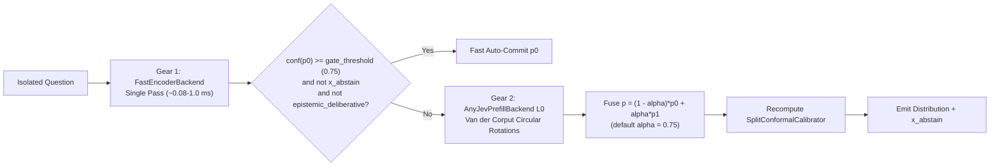

# ADR-001: Dual-Gear StartLux Cascade with Split Conformal Abstention

| Attribute | Value |
| :--- | :--- |
| **Status** | Accepted |
| **Date** | `2026-11-22` |
| **Deciders** | MicroLLM Architecture and Calibration Maintainers |
| **Supersedes** | None |

## Context

MicroLLM must satisfy three competing engineering constraints on commodity CPUs with zero mandatory GPU hardware:

- **Sub-5 ms Median Latency (`NFR-01`)**: Most production routing and guardrail calls must resolve in under `1 ms`
  to avoid adding perceptible overhead to interactive agent loops.
- **Zero Option-Order Bias (`NFR-03`)**: Permuting candidate labels in `choice` requests must yield zero decision
  flips and zero probability drift.
- **Zero Silent High-Confidence Failures (`NFR-04`)**: Empirical audits across `114,018` public rows and `11,000`
  structured cases ([`FAILURE_MODES_AND_WORST_CASES.md`](../../FAILURE_MODES_AND_WORST_CASES.md)) show that
  single-pass lightweight encoders struggle on multi-hop logic (`ChoiceBench` `23.19%`), overlapping fine-grained
  classes (`Banking77` `61.02%`), role-play jailbreaks (`WildGuardMix` `28.25%` recall), and concessive negations.

Choosing either an always-fast single-pass encoder or an always-deep multi-pass prefill model violates at least one
of these constraints.

## Cascade Topology

## Options Considered and Trade-Offs

| Option | CPU Latency (`p50` / `p95`) | Order-Flip Drift | Hard-Case & Negation Handling | Uncertainty & Abstention Safety | Verdict |
| :--- | :--- | :--- | :--- | :--- | :--- |
| **Option A: Gear 1 Only (`FastEncoderBackend`)** | `0.076 ms`–`0.367 ms` (`< 1 ms`) | `0.000000` (hash/lexicon), vulnerable if backed by causal scorer | Weak on concessive negation, deliberative exemptions, and overlapping concepts | Needs external conformal wrapper; otherwise silent errors occur on ties | Rejected |
| **Option B: Gear 2 Only (`AnyJevPrefillBackend` $L_0$)** | `2x`–`K` rotations on every call (`20 ms`–`50+ ms` with neural/SLM scorers) | `0.000000` via Theorem 1 circular averaging | Strongest on order sensitivity and SLM logprob disambiguation | Computes `answer_mass_gate_passed` per call, but wastes CPU/SLM budget on trivial requests | Rejected |
| **Option C: Dual-Gear StartLux Cascade with Split Conformal Abstention** | `p50 < 1 ms` fast path; escalates only uncertain/deliberative traffic | `0.000000` canonical order invariance | Routes deliberative markers and ambiguous margins to Gear 2 fusion ($\alpha = 0.75$) | Re-evaluates `SplitConformalCalibrator` on fused simplex to emit `x_abstain` (`100%` of 27/11,000 failures intercepted below $\tau = 0.45$) | **Selected** |

## Decision

Adopt **Option C**: deploy `DualGearCascadeBackend` (`jev-latest`) combining `FastEncoderBackend` (Gear 1) with
`AnyJevPrefillBackend` (Gear 2) via the StartLux *Read-or-Think* cascade (`gate_threshold = 0.75`, `alpha = 0.75`),
gated by `evaluate_voc_gate_regime` and `SplitConformalCalibrator` (`alpha = 0.10`).

Unambiguous inputs commit on Gear 1. Ambiguous predictions (`|C_\alpha(x)| \neq 1`), low-confidence outputs
(`confidence < gate_threshold`), and inputs containing deliberative policy markers escalate to Gear 2 and fuse
via $(1 - \alpha) p_0 + \alpha p_1$. Inputs that remain ambiguous after fusion retain `x_abstain = True` for
downstream System-2 LLM or human escalation.

## Consequences

### Positive

- **Pareto Latency-Accuracy Frontier**: Keeps median CPU latency under `1 ms` on routine traffic while avoiding
  unnecessary Gear 2 passes (`84.09%` System-2 avoidance on the `220`-item `microllm-guard` benchmark).
- **Certified Selective Reliability**: In the `11,000`-case structured suite, all `27` failures fell strictly
  below the selective confidence threshold $\tau = 0.45$ (`100%` interception before user delivery).
- **Graceful Hardware Scaling**: Operators can run deterministic zero-dependency CPU scoring on edge nodes or attach
  `ONNX`, `HuggingFace`, or local `Ollama`/`vLLM`/`llama.cpp` scorers on Gear 2 without changing API contracts.

### Negative and Operational Risks

- **Bimodal Tail Latency**: Workload shifts that increase ambiguous or deliberative traffic spike `p95`/`p99`
  latency as more requests trigger Gear 2 rotations or external SLM calls.
- **False-Negative Escalation Risk**: Deceptive high-frequency keywords in Gear 1 can inflate $c_0 \ge g$, bypassing
  Gear 2 unless deliberative markers (`evaluate_voc_gate_regime`) or policy checks intercept them.
- **Threshold Calibration Drift**: Shifting domain priors alter optimal $(g, \alpha)$ operating points, requiring
  periodic re-tuning via `tune_cascade_pareto` and `PerKTemperatureScaler` recalibration.

## Related Reference and Operational Guides

- Configuration parameters, defaults, and model profiles:
  [Environment and Model Profiles Reference](../../03-reference/configuration/environment-and-model-profiles.md)
- Production mitigation runbook for abstention and latency spikes:
  [Abstention & Latency Runbook](../../02-how-to-guides/incident-response/remediate-abstention-or-latency-spike.md)
- Mathematical derivations for Per-$K$ scaling, conformal sets, and $L_0$ cancellation:
  [Calibration and Order Invariance Deep Dive](../deep-dives/calibration-and-order-invariance.md)
