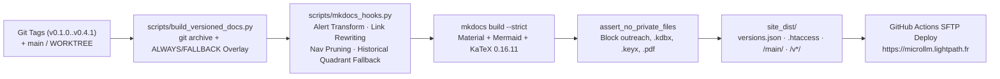

# ADR-002: Diátaxis 4-Quadrant Documentation and Versioned MkDocs Material Publishing

| Attribute | Value |
| :--- | :--- |
| **Status** | Accepted |
| **Date** | `2026-11-22` |
| **Deciders** | MicroLLM Contributors, Platform Documentation Engineering |
| **Supersedes** | None |

## Context

MicroLLM documentation grew across `20+` top-level files (`README.md`, `PRODUCT_DOCUMENTATION.md`,
`TECHNICAL_SPECIFICATIONS.md`, `ALGORITHMS.md`, `SYLLABUS.md`, `LITERATURE_REVIEW.md`, and living governance
registers) alongside interactive browser artifacts (`docs/index.html` and `docs/slides.html`). As release cadence
progressed (`v0.1.0`, `v0.3.0`, `v0.4.0`, `v0.4.1`) and deployment moved to `https://microllm.lightpath.fr` on IONOS
static Apache hosting, four structural problems emerged:

1. **Genre Mixing**: Tutorials, production commands, reference specifications, and mathematical justifications
   coexisted in long monolithic documents, slowing down on-call incident recovery and user onboarding.
2. **Immutable Historical Releases**: Git tags `v0.1.0` through `v0.4.1` predate MkDocs Material adoption and lack
   `mkdocs.yml`, CSS/JS math helpers, and quadrant directories.
3. **Static Shared Hosting Constraints**: IONOS Apache requires pure static HTML/JS/CSS artifacts,
   subpath-preserving `.htaccess` redirects (`/`, `/latest/`, `/dev/`), and strict privacy filtering so local
   outreach files, KeePass vaults (`*.kdbx`, `*.keyx`), and paper PDFs (`docs/papers/*.pdf`) never reach public web
   directories.
4. **Dual-Environment Link Integrity**: Relative Markdown links must resolve both on GitHub / local
   `diataxis_check.py` and inside nested MkDocs HTML URLs without breaking `pytest` on lightweight `.[dev]` CI runners
   lacking `mkdocs`.

## Multi-Version Build and Publishing Pipeline

## Options Considered and Trade-Offs

| Option | Genre Clarity & Runbook Safety | Multi-Version Tag Support | Static Apache Hosting & Privacy | Maintenance & CI Enforcement | Verdict |
| :--- | :--- | :--- | :--- | :--- | :--- |
| **Option A: Single Flat `docs/` Directory (Flat Jekyll)** | Low: mixes theory, tutorials, and commands in long files | None: renders only one branch snapshot | No version switcher; manual link maintenance | No automated structural or STE procedural checks | Rejected |
| **Option B: Unversioned MkDocs Material (`main` Only)** | Medium: adds tabs and search, but lacks quadrant guardrails without restructuring | None: PyPI users on older tags see mismatched docs | Static HTML works, but lacks `/latest/` and `/v*/` routing | Requires separate link rewriting for root `BENCHMARKS.md` and `CHANGELOG.md` | Rejected |
| **Option C: Diátaxis 4-Quadrant Tree + Versioned MkDocs Material with Tag Overlay** | High: isolates `01-tutorials/`, `02-how-to-guides/` (ASD-STE100), `03-reference/`, and `04-explanation/` | Full: builds `main` (`/dev/`) and all semver tags (`v0.1.0`–`v0.4.1`, `/latest/`) via `git archive` overlay | Full: static `site_dist/` with `.htaccess` `301`/`302` rules, `versions.json`, and `exclude_docs` + post-build leak guard | Automated via `diataxis_check.py`, `.vale.ini`, `.markdownlint.json`, `docs-ci.yml`, and `docs-publish.yml` | **Selected** |

## Decision

Adopt **Option C**: structure active documentation into the four canonical Diátaxis quadrants (`docs/01-tutorials/`,
`docs/02-how-to-guides/`, `docs/03-reference/`, `docs/04-explanation/`) while retaining existing canonical root
documents in `nav:` for backward traceability, and publish versioned static bundles via
`scripts/build_versioned_docs.py` and `scripts/mkdocs_hooks.py` to IONOS Apache (`https://microllm.lightpath.fr`).

Key implementation mechanisms include:

- **Docs-as-Code Quality Gates**: `.vale.ini` enforces strict procedural rules on `docs/02-how-to-guides/**/*.md`,
  `.markdownlint.json` validates Markdown structure, and `.github/workflows/docs-ci.yml` runs
  `test_diataxis_documentation.py` alongside `mkdocs build --strict`.
- **Immutable Tag Overlay (`APP-021`)**: `build_single_version` extracts each historical release tag via
  `git archive` into a temporary directory, overlays `ALWAYS_OVERLAY_FILES` (`mkdocs.yml`, `scripts/mkdocs_hooks.py`,
  `extra.css`, `katex.js`) and `FALLBACK_OVERLAY_FILES`, and relies on `prune_nav_for_existing_files` plus
  historical-tag quadrant fallbacks in `scripts/mkdocs_hooks.py` so older tags compile under `--strict`.
- **Dependency Isolation (`RCA-098`)**: `scripts/mkdocs_hooks.py` lazily imports `mkdocs` and `pathspec` inside
  `on_files` and `on_config` so core `.[dev]` unit-test environments execute hook tests without requiring `.[docs]`.

## Consequences

### Positive

- **Zero-Ambiguity Operations**: On-call operators locate exact parameters in `03-reference/` and strict ASD-STE100
  Issue 9 steps in `02-how-to-guides/` without reading theoretical prose during incidents.
- **Historical Version Parity**: Every tagged release (`v0.1.0` through `v0.4.1` and future `v*` tags) remains
  browsable via `provider: mike` (`versions.json`) and subpath-preserving `.htaccess` redirects.
- **Defense-in-Depth Privacy**: Triple-layered exclusions (`.gitignore`, `mkdocs.yml` `exclude_docs`, and
  `assert_no_private_files`) prevent private vaults, outreach records, or paper PDFs from deploying.

### Negative and Operational Risks

- **Overlay Coupling on Historical Tags**: Updating `mkdocs.yml` or `docs/index.md` requires verifying that
  `prune_nav_for_existing_files` and historical-tag fallbacks still build cleanly against `v0.1.0`–`v0.4.1` snapshots
  (`--strict`).
- **Relative Path Depth Sensitivity**: Moving files across nested quadrant subdirectories requires depth-aware
  relative link resolution in `scripts/mkdocs_hooks.py` and full relative-link validation in CI.
- **External CDN Dependency for KaTeX**: Client browsers load KaTeX stylesheets and scripts from `cdn.jsdelivr.net`;
  offline intranet mirrors would need vendored static copies under `docs/javascripts/`.

## Related Reference and Operational Guides

- CLI flags, exit codes, and `build_versioned_docs.py` arguments:
  [CLI Commands and Exit Codes Reference](../../03-reference/cli-and-scripts/cli-commands-and-exit-codes.md)
- Container and service deployment procedure:
  [Deploy MicroLLM with Docker](../../02-how-to-guides/deployment/deploy-microllm-docker.md)
- System architecture topology:
  [Dual-Gear System-1 Topology](../architecture-overview/dual-gear-system1-topology.md)
