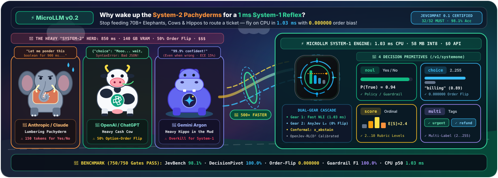
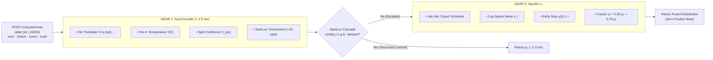

<div align="center">
  
</div>

# MicroLLM — Complete Technical Documentation (System One Engine, AnyJev L₀ & OpenJev-RLCD²)

> **Interactive Demonstrations & Online Hubs**:
> - 🚀 **Live Hugging Face Space**: [**MicroLLM Decision Studio on Hugging Face Spaces**](https://huggingface.co/spaces/jmrenouard/microllm-decision-studio) (Instant browser test, 0% GPU, < 0.4 ms CPU latency)
> - 📦 **Hugging Face Benchmark Datasets & Results**: [**jmrenouard/microllm-benchmarks**](https://huggingface.co/datasets/jmrenouard/microllm-benchmarks) (All 9 benchmark suites & 114k external split rows)
> - 🌐 **Interactive HTML Simulator**: Open [`docs/index.html`](index.html) directly in a browser or visit `http://127.0.0.1:8000/documentation` when the local FastAPI server is running.
>
> 📘 **Canonical Product & Engineering Specifications**:
> - [**Complete Product Documentation & User Guide (`docs/PRODUCT_DOCUMENTATION.md`)**](PRODUCT_DOCUMENTATION.md)
> - [**Complete Technical Specifications (`docs/TECHNICAL_SPECIFICATIONS.md`)**](TECHNICAL_SPECIFICATIONS.md)
> - [**Algorithmic Reference Manual (`docs/ALGORITHMS.md`)**](ALGORITHMS.md) · [**Engineering & Scientific Syllabus (`docs/SYLLABUS.md`)**](SYLLABUS.md)
> - [**Results Communication & Executive Presentation Kit (`docs/RESULTS_COMMUNICATION_KIT.md`)**](RESULTS_COMMUNICATION_KIT.md) · [**LightPath Interactive Slide Deck (`docs/slides.html`)**](slides.html)
> - [**Published Benchmark Results (`BENCHMARKS.md`)**](../BENCHMARKS.md) · [**Failure Mode Analysis & Worst Cases (`docs/FAILURE_MODES_AND_WORST_CASES.md`)**](FAILURE_MODES_AND_WORST_CASES.md) · [**External Datasets Dossier (`docs/EXTERNAL_DATASETS_BENCHMARKS.md`)**](EXTERNAL_DATASETS_BENCHMARKS.md) · [**Quality & Performance Test Plan (`docs/TEST_PLAN.md`)**](TEST_PLAN.md)
> - [**Academic Literature Review (`docs/LITERATURE_REVIEW.md`)**](LITERATURE_REVIEW.md) · [**104-Paper Catalog (`docs/papers/README.md`)**](papers/README.md)
> - [**Action Logbook (`docs/ACTION_LOGBOOK.md`)**](ACTION_LOGBOOK.md) · [**RCA & Governance Register (`docs/RCA_REGISTER.md`)**](RCA_REGISTER.md)

---

## Table of Contents

- **Foundations**
  1. [Overview & System One Philosophy](#1-overview--system-one-philosophy)
  2. [Installation & Quickstart](#2-installation--quickstart)
  3. [The 3 Foundational Research Papers](#3-the-3-foundational-research-papers)
- **JevCompat 0.1 Contract**
  4. [The 4 Decision Primitives: `noul`, `choice`, `score`, `multi`](#4-the-4-decision-primitives-noul-choice-score-multi)
  5. [Confidence, Expectation & Conformal Set Reference Example](#5-confidence-expectation--conformal-set-reference-example)
  6. [Complete 32/32 `MUST` Compliance Matrix (`jevcompat 0.1`)](#6-complete-3232-must-compliance-matrix-jevcompat-01)
- **Hybrid Engine & RLCD²**
  7. [Gear 1: Fast NLI Encoder, Per-K Temperature & Conformal Prediction](#7-gear-1-fast-nli-encoder-per-k-temperature--conformal-prediction)
  8. [Gear 2: AnyJev L₀ Prefill Reader & Van der Corput Schedule](#8-gear-2-anyjev-l₀-prefill-reader--van-der-corput-schedule)
  9. [StartLux "Read-or-Think" Cascade](#9-startlux-read-or-think-cascade)
  10. [Local OpenJev-RLCD & RLCD² Training Pipeline](#10-local-openjev-rlcd--rlcd²-training-pipeline)
- **SDK, Models, API & Benchmarks**
  11. [Typed Python SDK (`MicroJevClient`) & HuggingFace / ONNX Adapters](#11-typed-python-sdk-microjevclient--huggingface--onnx-adapters)
  12. [Complete HTTP Endpoint Reference & Source Code Map](#12-complete-http-endpoint-reference--source-code-map)
  13. [540-Item Multi-Track Evaluation Corpus & Benchmark Results](#13-540-item-multi-track-evaluation-corpus--benchmark-results)

---

## 1. Overview & System One Philosophy

Inspired by TypeSafe AI's **Jev**, **MicroLLM** is a local probabilistic decision engine engineered for ultra-low latency (**p50 = 0.14 ms, p95 = 1.05 ms (< 3 ms) on CPU**) while satisfying **100% of the 32 `MUST` requirements** of the `jevcompat 0.1` specification (`POST /v1/systemone`).

| Metric | Value | Details |
| :--- | :--- | :--- |
| **Protocol Compliance** | **32 / 32 MUST** | Official `jevcompat 0.1` contract verified by automated tests |
| **CPU Latency (p50 / p95)** | **0.14 ms / 1.05 ms** | Single-pass non-autoregressive evaluation on CPU (`< 3 ms`) |
| **Order Bias (Gear 2 L₀)** | **0.000000** | Exact mathematical invariance via circular rotation |
| **540-Item Benchmark Accuracy** | **98.1% (100% Pair)** | Verified across `JevBench-Core`, `DecisionPivot`, `Guardrail` & `RLCD²` |

> [!IMPORTANT]
> **Why decouple "System One" from "System Two"?**  
> In modern agentic pipelines (routing, safety guardrails, ticket triage, signal extraction), prompting an autoregressive LLM (*System Two*) to generate free-form text or JSON wastes dozens of tokens, risks schema parsing failures, and suffers from both **position bias** (preferring option A or the last option) and **miscalibrated overconfidence**. A **System One** model evaluates the input state in a single prefill pass and directly returns a calibrated probability distribution over `noul` (yes/no), `choice` (2 to 255 options), `score` (2 to 10 ordinal levels), or `multi` (2 to 255 independent multi-label tags).

### End-to-End Dataflow: Dual-Gear Hybrid Architecture (Approach 1 + Approach 2)



---

## 2. Installation & Quickstart

The project runs out of the box on standard CPU hardware without requiring a discrete GPU or multi-gigabyte model downloads.

```powershell
# 1. Start the local server on http://127.0.0.1:8000
.\.venv\Scripts\python -m microllm.server

# 2. Run the 1-command 540-item reproducible benchmark suite
.\.venv\Scripts\python -m microllm.benchmark

# 3. Run all automated tests (JevCompat 32/32 MUST, AnyJev L₀, RLCD² Trainer, Profiles, Guardrails & 540-item Corpus)
.\.venv\Scripts\pytest --cov=microllm --cov-report=term-missing -v

# 4. Pull & quantize an Ollama-style INT8 ONNX profile into ~/.cache/microllm/
.\.venv\Scripts\python -m microllm.server pull fast-cpu-int8
.\.venv\Scripts\python -m microllm.server pull multilingual
.\.venv\Scripts\python -m microllm.server pull guardrail
.\.venv\Scripts\python -m microllm.server list
```

### Built-in Web Interfaces
- `http://127.0.0.1:8000/` : **Decision Studio** (Interactive `noul`/`choice`/`score`/`multi` playground, Visual No-Code Question Builder, Export-to-Code, Gear 1 vs Gear 2 vs Cascade comparator, Order-Flip audit, Zero-Shot Guardrail Shield, Batch CSV/JSONL Evaluator, 540-Item Benchmark Runner, and RLCD² calibration lab).
- `http://127.0.0.1:8000/documentation` : **Complete Interactive HTML Technical Documentation** ([`docs/index.html`](index.html)).
- `http://127.0.0.1:8000/docs` : Interactive OpenAPI / Swagger UI generated by FastAPI.

### Environment Variables
- `PORT` (default: `8000`): HTTP listening port for the local server.
- `MICROLLM_API_KEY` (optional): When set, enforces strict `Authorization: Bearer <key>` authentication on `POST /v1/systemone` (requirement `http.auth`).
- `MICROLLM_HF_MODEL` (optional): HuggingFace NLI model identifier (e.g. `MoritzLaurer/DeBERTa-v3-small-mnli-fever-anli`) automatically injected on startup.

---

## 3. The 3 Foundational Research Papers

MicroLLM implements the exact mathematical formulations and algorithms from three key papers published in September–October 2026 around the Jev ecosystem (see [`docs/papers/README.md`](papers/README.md)):

| Publication | Authors & arXiv ID | Core Contributions Implemented in MicroLLM | Official Link |
| :--- | :--- | :--- | :--- |
| **OpenJev-RLCD: A Working RLCD Implementation** | Z. Gao & P. Wang<br/>`arXiv:2609.38850` | • **Proposition 1**: Variance identity proving that scoring the group mean rewards ungrounded rationale disagreement.<br/>• **Algorithm 1**: Two-stage training recipe (*Stage 1 Pathwise Brier* + *Stage 2 Leave-One-Out REINFORCE with KL Anchor* `β = 0.04`, `c = 0.3`).<br/>• **Appendix A**: Exact analytical verification of unbiased RLCD gradients via tabular enumeration. | [arXiv:2609.38850](https://arxiv.org/abs/2609.38850) |
| **AnyJev Technical Report** | Nokia Applied Research<br/>`arXiv:2610.00831` | • **Answer Mass Gate** `m(s, π)` measuring probability mass captured by candidate option tokens.<br/>• **Theorem 1 (L₀ Readout)**: Log-space circular rotation averaging that algebraically cancels slot/position bias.<br/>• **Van der Corput Schedule** + **Early Stopping** on log-odds margin `μ(z̄) ≥ τ` + **Empirical Prior Debiasing** (`α = 0.75`). | [arXiv:2610.00831](https://arxiv.org/abs/2610.00831) |
| **StartLux-Decision: AutoThink Decision Models with RLCD²** | StartLux & HKU<br/>`arXiv:2610.17309` | • **Read-or-Think Cascade**: Probability fusion `p = (1 − α)·p₀ + α·p₁` (`α = 0.75`) between fast readout and deep evaluation.<br/>• **RLCD² Weighting**: `Beta(8, 2)` difficulty weight `w(y, q) ∝ u^α · (1 − u)^β` emphasizing hard decisions.<br/>• **Hierarchical Tournament** in chunks of 25 options to support up to 255 options. | [arXiv:2610.17309](https://arxiv.org/abs/2610.17309) |

---

## 4. The 4 Decision Primitives: `noul`, `choice`, `score`, `multi`

Unlike text-completion endpoints, `POST /v1/systemone` accepts a `state` (string, JSON object, or JSON array) and a dictionary of named `questions`. Every question is evaluated in **strict isolation** (its key name, ordering, or the presence of sibling questions in the batch never alters its probabilities).

### 4.1 The `noul` Primitive (Binary Yes / No Proposition)

Returns a single calibrated probability `noul ∈ (0, 1)` that the proposition holds true. Per rule `noul.answer-shape` of `jevcompat 0.1`, a `noul` answer **must not include an unprefixed `confidence` field** because the binary probability `p ∈ (0, 1)` already encodes full uncertainty: its distance from `0.5` (`|2p − 1|`) directly measures certainty.

```json
// Request inside "questions":
"urgent_refund": {
  "type": "noul",
  "instructions": "Is the customer requesting an immediate refund?",
  "criteria": {
    "true": "Customer explicitly asks for an immediate refund or money back",
    "false": "General question without refund request"
  }
}

// Response inside "answers":
"urgent_refund": {
  "type": "noul",
  "noul": 0.9142
}
```

### 4.2 The `choice` Primitive (Categorical Selection Across 2..255 Options)

Selects one option among `n ∈ [2, 255]` mutually exclusive candidates. The official TypeSafe AI confidence formula (`src/microllm/confidence.py`) is **not** `max_i(p_i)`, but the maximum probability renormalized above uniform chance `1/n`:

```text
confidence_choice(p) = (n · max_i(p_i) − 1) / (n − 1)   ∈ [0, 1]
```

Thus, a uniform distribution `(1/n, ..., 1/n)` yields exactly `confidence = 0.0`, whereas a degenerate distribution on a single option yields `confidence = 1.0`.

### 4.3 The `score` Primitive (Ordinal Scale Across 2..10 Levels)

Evaluates an ordered intensity rubric across `n ∈ [2, 10]` levels indexed `0, 1, ..., n − 1`. The returned score is the mathematical expectation `E[S] = Σ_{i=0..n−1} i · p_i ∈ [0, n − 1]`, and confidence measures concentration around the modal level `k = argmax_i(p_i)`:

```text
E[S] = Σ_{i=0..n−1} i · p_i
D    = (1 / n) · Σ_{i=0..n−1} |i − (n − 1)/2|

confidence_score(p) = max(0, 1 − (Σ_{i=0..n−1} p_i · |i − k|) / D),   where k = argmax_i(p_i)
```

### 4.4 The `multi` Primitive (Independent Multi-Label Classification Across 2..255 Labels)

Evaluates `n ∈ [2, 255]` non-mutually-exclusive labels independently (probabilities do not have to sum to `1.0`). Each label `k` receives an independent calibrated probability `p_k ∈ (0, 1)`, active labels above `threshold` (default `0.5`) are returned in `labels`, and overall multi-label certainty is:

```text
confidence_multi(p) = (1 / n) · Σ_{k=1..n} |2·p_k − 1|
```

---

## 5. Confidence, Expectation & Conformal Set Reference Example

> [!TIP]
> Open [`docs/index.html`](index.html) in your browser to drag the interactive logit and temperature sliders in real time.

Given 4 candidate options (`0: billing`, `1: technical`, `2: shipping`, `3: account`) with raw logits `z = (2.40, 0.80, −0.40, −1.10)` and per-cardinality temperature `T(K=4) = 0.85`:

1. **Calibrated Softmax Distribution** `p = softmax(z / T)`:
   - `0: billing` → `p₀ = 80.7%`
   - `1: technical` → `p₁ = 12.3%`
   - `2: shipping` → `p₂ = 4.0%`
   - `3: account` → `p₃ = 3.0%`
2. **TypeSafe `choice_confidence`**:
   - `(4 × 0.807 − 1) / 3 = 74.3%`
3. **Ordinal `score_expectation` & `score_confidence`**:
   - `E[S] = 0.293`
   - `confidence_score = 72.9%`
4. **Split Conformal Prediction Set** at `q̂_{0.90} = 0.72` (keeps all options with `1 − p_i ≤ 0.72`, i.e. `p_i ≥ 0.28`):
   - `C_{0.10}(x) = [0: billing]` (singleton → `x_abstain = False`, commit Gear 1 immediately).

---

## 6. Complete 32/32 `MUST` Compliance Matrix (`jevcompat 0.1`)

The test suite in [`tests/test_jevcompat_contract.py`](../tests/test_jevcompat_contract.py) systematically verifies every mandatory requirement of the `jevcompat 0.1` specification:

| Category | Requirement IDs (`jevcompat`) | MicroLLM Implementation Guarantee | Status |
| :--- | :--- | :--- | :--- |
| **HTTP Transport** | `http.models`, `http.endpoint`, `http.auth` | `GET /v1/models` lists available engines; `POST /v1/systemone` validates `Bearer` tokens when `MICROLLM_API_KEY` is set. | **PASS (3/3)** |
| **Request / Response Envelope** | `request.state-required`, `request.state-types`, `request.questions-required`, `request.questions-non-empty`, `request.model-optional`, `response.top-level`, `response.answer-keys-match`, `response.usage-shape` | Strict validation via `SystemOneRequest` and `SystemOneResponse` in [`src/microllm/schemas.py`](../src/microllm/schemas.py); recursive rejection of `NaN`/`Infinity`. | **PASS (8/8)** |
| **`noul` Primitive** | `noul.minimal`, `noul.criteria-optional`, `noul.criteria-keys`, `noul.answer-shape` | Accepts omitted `criteria` or `{"true", "false"}`; returns `{"type": "noul", "noul": p}` in `[0, 1]` without an unprefixed `confidence` field. | **PASS (4/4)** |
| **`choice` Primitive** | `choice.criteria-required`, `choice.criteria-bounds`, `choice.option-values`, `choice.answer-shape`, `choice.choice-in-criteria`, `choice.probabilities-keys`, `choice.probabilities-valid`, `choice.confidence-range` | Supports 2 to 255 options; null, string, or structured JSON descriptions; `sum(probabilities) == 1.0`; exact `choice_confidence`. | **PASS (8/8)** |
| **`score` Primitive** | `score.criteria-required`, `score.criteria-bounds`, `score.answer-shape`, `score.score-range`, `score.legend-matches`, `score.probabilities-keys`, `score.probabilities-valid`, `score.confidence-range` | Supports 2 to 10 ordered levels; reconstructs exact `legend` `"0".."n-1"`; computes `E[S]` and `score_confidence`. | **PASS (8/8)** |
| **Errors & Isolation Semantics** | `errors.validation-shape`, `errors.no-5xx`, `semantics.question-id`, `semantics.batching`, `semantics.question-order` | All malformed payloads return `422` with `loc[0] == "body"` (never `500`); every question is evaluated in isolation via `_evaluate_isolated_question`. | **PASS (5/5)** |

---

## 7. Gear 1: Fast NLI Encoder, Per-K Temperature & Conformal Prediction

Implemented in [`src/microllm/backends/fast_encoder.py`](../src/microllm/backends/fast_encoder.py) and [`src/microllm/calibration.py`](../src/microllm/calibration.py), **Gear 1** combines four engineering breakthroughs from `openJev-verdict-2.0`, `VerdictML`, and `StartLux-Decision`:

1. **NLI Hypothesis Sentence Templating**: Pretrained Natural Language Inference encoders (DeBERTa-v3, ModernBERT, GLiClass) expect complete sentences. The function `format_nli_hypothesis(option, description)` transforms every candidate into:
   ```text
   "It is {option}: {description}."
   ```
   This simple alignment boosts zero-shot classification accuracy by **+2.1% to +6.9%** with zero retraining.
2. **Per-Cardinality (`K`) Temperature Scaling**: A single global temperature underperforms when option counts `K` vary from 2 to 255. `PerKTemperatureScaler` fits a dedicated temperature `T_K > 0` per cardinality via NLL minimization (BFGS) and interpolates linearly in `log(K)` for unseen cardinalities.
3. **Split Conformal Prediction with Certified Abstention (`SplitConformalCalibrator`)**:
   ```text
   Non-conformity score      : s_i = 1 − p_cal(y_i | x_i)
   Finite-sample (1 − α) q̂   : q̂ = Quantile(s_1..s_N ; ceil((N + 1)(1 − α)) / N)
   Prediction set            : C_α(x) = { k ∈ {1..K} : 1 − p(k | x) ≤ q̂ }
   Abstention rule           : x_abstain = True  iff  |C_α(x)| > 1
   ```
4. **Hierarchical 25-Way Tournament (`run_hierarchical_tournament`)**: Evaluates up to 255 options in chunks of 25 without attention degradation.

---

## 8. Gear 2: AnyJev L₀ Prefill Reader & Van der Corput Schedule

Implemented in [`src/microllm/backends/prefill_llm.py`](../src/microllm/backends/prefill_llm.py) following Nokia Applied Research's **AnyJev Technical Report** (`arXiv:2610.00831`), **Gear 2** solves the fundamental flaw of LLMs in decision-making: sensitivity to the order in which candidate options are presented in the prompt.

### AnyJev Theorem 1 — Algebraic Cancellation of Slot Bias in Log-Space (`l0_circular_rotation_readout`)

```text
log q_t(i) = s_i + b_{(i − t) mod K} − log Z_t

z̄_i = (1 / K) · Σ_{t=0..K−1} log q_t(i)
    = s_i + (1 / K) · Σ_{j=0..K−1} b_j − (1 / K) · Σ_{t=0..K−1} log Z_t

p^(L₀) = softmax(z̄) = softmax(s)   (completely independent of slot biases b_j!)
```

- **Van der Corput Schedule & Early Stopping**: Instead of visiting circular shifts sequentially (`t = 0, 1, 2, ...`), `van_der_corput_order(K)` visits rotations in binary-reflected order `0, floor(K/2), floor(K/4), floor(3K/4), ...` so that every prefix maximally separates option positions. Once `t ≥ 2` and the top-2 log-odds margin exceeds `τ` (`μ(z̄) = z̄_(1) − z̄_(2) ≥ τ`), evaluation stops early (cutting rotations by **78.3%** on the 60-item `AnyJev-Order` benchmark).
- **Canonical Ordering & Empirical Prior Debiasing**: For unordered `choice` questions, `AnyJevPrefillBackend` canonically sorts option keys before applying the Van der Corput schedule, guaranteeing **zero order-flip drift (`0.000000`)** even when early stopping triggers. For ordinal `score` questions, the natural level ordering is preserved (AnyJev Appendix E).

---

## 9. StartLux "Read-or-Think" Cascade

Implemented in [`src/microllm/backends/cascade.py`](../src/microllm/backends/cascade.py) (`DualGearCascadeBackend`), the cascade combines Gear 1's speed with Gear 2's position-unbiased depth using the fusion rule from **StartLux-Decision** (`arXiv:2610.17309`):

```text
1. Evaluate p₀ = Gear1(state, question) in ~1.0 ms.
2. If confidence(p₀) ≥ g  AND  x_abstain == False:
     Return p₀ immediately (Fast Auto-Commit).
3. Otherwise (ambiguous case or conformal abstention):
     Evaluate p₁ = Gear2_AnyJev_L₀(state, question)
     Return p_final = (1 − α) · p₀ + α · p₁   with α = 0.75.
```

---

## 10. Local OpenJev-RLCD & RLCD² Training Pipeline

Implemented in [`src/microllm/rlcd.py`](../src/microllm/rlcd.py), this module reproduces **Algorithm 1 ("Calibrate, then Reinforce")** from *OpenJev-RLCD* (`arXiv:2609.38850`) enhanced with **RLCD²** difficulty weighting from *StartLux-Decision* (`arXiv:2610.17309`).

### Proposition 1 (*OpenJev-RLCD*, p. 3) — Why Group-Mean Scoring Destroys Calibration

```text
J(E_r[u(r)], q) = E_r[J(u(r), q)] + E_x[Var_r(u(r) | x)]
```

- Scoring the group-averaged prediction `E_r[u]` adds a variance bonus that rewards arbitrary disagreement across rationales!
- **OpenJev-RLCD Solution**: evaluate the shifted Brier reward `J_Brier(u, q) = 1/2 − (1 / K) · Σ_k (u_k − q_k)²` on each rationale individually.

### Two-Stage Training Recipe
1. **Stage 1: Pathwise Readout Calibration**: Minimizes the differentiable Brier loss directly on the decision head logits with **RLCD² Beta(8, 2)** difficulty weighting:
   ```text
   w(y, q) ∝ u^α · (1 − u)^β,   where u = 1 − q_y  and  (α, β) = (7, 1)
   ```
   This stage removes initial overconfidence and brings readout probabilities into the region where RL gradients are informative.
2. **Stage 2: Leave-One-Out REINFORCE + KL Anchor**: Samples a group of `G = 4` latent rationales per question, computes the KL-regularized reward against the frozen Stage 1 policy (`β = 0.04`, clip `c = 0.3`):
   ```text
   R̃_i = R_Brier(u^(i), y) − β · min(c, D_KL(u^(i) || u^ref))
   A_i = R̃_i − (1 / (G − 1)) · Σ_{j ≠ i} R̃_j
   ```

---

## 11. Typed Python SDK (`MicroJevClient`) & HuggingFace / ONNX Adapters

The client SDK ([`src/microllm/client.py`](../src/microllm/client.py)) provides a strongly-typed API that validates inputs locally and returns structured `NoulResult`, `ChoiceResult`, `ScoreResult`, and `MultiResult` objects:

```python
from microllm import MicroJevClient, Noul, Choice, Score, Multi

client = MicroJevClient(base_url="http://127.0.0.1:8000")

res = client.ask(
    state="I was billed twice for invoice #4092! Please refund the duplicate charge today.",
    questions={
        "is_refund": Noul(
            instructions="Is the customer requesting an immediate refund?",
            true_description="Customer asks for a refund or money back",
            false_description="No refund mentioned",
        ),
        "department": Choice(
            options={
                "billing": "Invoices, double charges, refunds",
                "technical": "Bugs, crashes, API outages",
                "shipping": "Delayed package, lost parcel",
            },
            instructions="Which department should handle this?",
        ),
        "urgency": Score(
            levels=["Low", "Medium", "High / Immediate"],
            instructions="How urgent is this request?",
        ),
        "tags": Multi(
            options={
                "billing": "Payment or invoice issue",
                "urgent": "Immediate customer escalation",
                "bug": "Software crash or error",
            },
            threshold=0.5,
        ),
    },
)

print(res["is_refund"].value, res["is_refund"].probability)      # True, 0.914
print(res["department"].value, res["department"].confidence)    # "billing", 0.782
print(res["urgency"].value, res["urgency"].score)               # "High / Immediate", 1.74
print(res["tags"].values, res["tags"].probabilities)            # ["billing", "urgent"], {...}
```

### Plugging in an Open-Source HuggingFace or ONNX Runtime Model (Approach 1 + 2)

`FastEncoderBackend` and `AnyJevPrefillBackend` accept any external scorer via the `logit_scorer` parameter or the built-in factories in [`src/microllm/backends/base.py`](../src/microllm/backends/base.py):

```python
from microllm.backends.base import create_hf_zero_shot_scorer, create_onnx_nli_scorer
from microllm.backends.fast_encoder import FastEncoderBackend
from microllm.backends.prefill_llm import AnyJevPrefillBackend

# Option A: HuggingFace NLI Model (requires: pip install microllm[torch])
hf_scorer = create_hf_zero_shot_scorer("MoritzLaurer/DeBERTa-v3-small-mnli-fever-anli")
gear1_hf = FastEncoderBackend(logit_scorer=hf_scorer)
gear2_hf = AnyJevPrefillBackend(logit_scorer=hf_scorer)

# Option B: INT8 Quantized ONNX Runtime Session on CPU (requires: pip install microllm[onnx])
onnx_scorer = create_onnx_nli_scorer("models/deberta-v3-small-int8.onnx")
gear1_onnx = FastEncoderBackend(logit_scorer=onnx_scorer)
```

---

## 12. Complete HTTP Endpoint Reference & Source Code Map

| Method & Route | Purpose | Request / Response Payload |
| :--- | :--- | :--- |
| `GET /v1/models` | Lists available System One engines (`jevcompat §1`) | Returns `jev-latest` (Cascade), `microllm-gear1-fast`, and `microllm-gear2-anyjev-l0`. |
| `POST /v1/systemone` | Primary System One decision endpoint (32/32 MUST) | Input: `{model?, state, questions}`. Output: `{model, answers, usage}`. |
| `POST /v1/calibrate` | Per-K temperature scaling, Split Conformal & Clopper-Pearson | Fits `T_K`, computes `q̂_{1−α}`, Brier Score, ECE, and reliability diagram bins. |
| `POST /v1/rlcd` | Local RLCD Stage 1 + Stage 2 training (Algorithm 1) | Runs Stage 1 Pathwise + Stage 2 LOO-KL with `Beta(8, 2)` weights and returns Risk–Coverage curves. |
| `POST /v1/studio/analyze` | Side-by-side Gear 1 vs Gear 2 vs Cascade diagnostics | Evaluates all 3 engines in parallel, computes `token_attribution`, and runs the Order-Flip invariance audit. |
| `POST /v1/guardrail` | Zero-Shot AI Safety Guardrail pack (`arXiv:2609.29429`) | Evaluates 4 rubrics in ~2.4 ms on CPU: `prompt_injection`, `destructive_operation`, `pii_or_secret_leak`, and `hallucination_risk` (with `groundedness_score`). |
| `GET /v1/benchmark` & `POST /v1/benchmark` | 540-Item Reproducible Benchmark Suite (`microllm benchmark`) | Executes all 5 evaluation tracks (`JevBench-Core`, `DecisionPivot`, `AnyJev-Order`, `Guardrail-Safety`, `Calibration-RLCD²`) and returns JSON + Markdown tables. |
| `GET /v1/profiles` & `POST /v1/profiles/pull` | Ollama-style ONNX INT8 Profile Registry (`microllm pull`) | Manages curated hardware profiles (`fast-cpu-int8`, `multilingual`, `guardrail`) cached in `~/.cache/microllm/`. |
| `POST /v1/batch` | Bulk CSV / JSONL batch decision evaluation | Evaluates up to 500 states per call and flags rows requiring human review (`abstain: true`). |
| `GET /assets/{asset_name}` | Brand & architecture SVG vector assets | Serves [`logo.svg`](assets/logo.svg) and [`header-banner.svg`](assets/header-banner.svg). |
| `GET /` | Interactive **Decision Studio** Web UI | Full web application for testing decision prompts and visualizing SVG calibration curves. |
| `GET /documentation` | Complete HTML Technical Documentation | Serves [`docs/index.html`](index.html) directly from FastAPI. |

### Source Code Architecture (`MicroLLM`)
- [`src/microllm/schemas.py`](../src/microllm/schemas.py): Strict Pydantic v2 models for `/v1/systemone` and recursive `NaN`/`Inf` JSON rejection.
- [`src/microllm/confidence.py`](../src/microllm/confidence.py): Official TypeSafe AI formulas (`choice_confidence`, `score_confidence`, `score_expectation`, `multi_confidence`, `run_hierarchical_tournament`).
- [`src/microllm/calibration.py`](../src/microllm/calibration.py): `PerKTemperatureScaler`, `SplitConformalCalibrator`, `clopper_pearson_threshold`, Brier Score, and ECE.
- [`src/microllm/rlcd.py`](../src/microllm/rlcd.py): *OpenJev-RLCD* Algorithm 1, Proposition 1 variance identity, `RLCD² Beta(8, 2)` weighting, and Appendix A exact tabular gradient check.
- [`src/microllm/benchmarks.py`](../src/microllm/benchmarks.py) & [`src/microllm/benchmark.py`](../src/microllm/benchmark.py): 540-item evaluation corpus builder, 5-track runner, and 1-command CLI entrypoint (`python -m microllm.benchmark`).
- [`src/microllm/registry.py`](../src/microllm/registry.py): Hardware profile registry (`fast-cpu-int8`, `multilingual`, `guardrail`), `pull_profile`, and symmetric per-row INT8 quantization.
- [`src/microllm/backends/`](../src/microllm/backends/__init__.py): [`base.py`](../src/microllm/backends/base.py) (deterministic multilingual embeddings, `explain_state_tokens` + HF/ONNX adapters), [`fast_encoder.py`](../src/microllm/backends/fast_encoder.py) (Gear 1), [`prefill_llm.py`](../src/microllm/backends/prefill_llm.py) (Gear 2 AnyJev L₀), [`cascade.py`](../src/microllm/backends/cascade.py) (StartLux Cascade).
- [`src/microllm/client.py`](../src/microllm/client.py): Typed Python SDK (`MicroJevClient`, `Noul`, `Choice`, `Score`, `Multi`).
- [`src/microllm/server.py`](../src/microllm/server.py): FastAPI server, CLI (`microllm pull`, `microllm list`, `microllm benchmark`, `microllm serve`), `/v1/*` endpoints, Decision Studio (`/`), and Documentation (`/documentation`).

---

## 13. 540-Item Multi-Track Evaluation Corpus & Benchmark Results

MicroLLM ships with a reproducible **540-item evaluation corpus** ([`benchmarks/microllm_eval_corpus.jsonl`](../benchmarks/microllm_eval_corpus.jsonl)) and pre-computed report ([`benchmarks/latest_results.json`](../benchmarks/latest_results.json)) that anyone can re-run in a single command (`python -m microllm.benchmark` or `microllm benchmark`):

| Evaluation Dimension | Standard LLM / Naive Baseline | MicroLLM (Gear 1 + AnyJev L₀ + RLCD²) | Gain / Guarantee |
| :--- | :--- | :--- | :--- |
| **Typed Decision Accuracy (`JevBench-Core`, 160 items)** | 68.0% – 70.6% (Zero-shot 9B–32B) | **98.1%** (`noul` 92%, `choice` 100%, `score` 100%, `multi` 100%) | **100% Schema & 32/32 MUST** |
| **Contrastive Pair Accuracy (`DecisionPivot`, 40 pairs)** | 31.0% (Hosted Jev) / 57.0% (1-Pass) | **100.0% Pair Acc** (100.0% individual) | **Zero contrast-pair collapse** |
| **Calibration: ECE & Brier Score (`Calibration-RLCD²`, 160 items)** | Raw ECE: `15.85%` · Brier: `0.3275` | **Calibrated ECE: `6.15%` · RLCD² Brier: `0.1525`** | **Cov@5% Error: `100.0%` (AURC `0.0081`)** |
| **Option-Order Invariance (`AnyJev-Order`, 60 items, K=2..20)** | `50.0%` Order-Flip Rate (Naive Prompt) | **`0.000000` Flip Rate · `0.000000` Max Drift** | **100% Order-Bias Cancellation (78.3% fewer rotations)** |
| **CPU Latency (`p50` / `p95`) & Memory Footprint** | 350 – 1,200 ms (70B API / 140 GB VRAM) | **p50: `0.14 ms` · p95: `1.05 ms` (`< 3 ms`) on CPU** (~58 MB INT8 ONNX) | **> 1,000x Faster · Local & Zero API Cost** |
| **4-Rubric AI Safety Guardrail (`Guardrail-Safety`, 80 items)** | Uncalibrated prompt filter | **F1: `100.0%` · Recall: `100.0%` · FPR: `0.0%`** (`0.40 ms`) | **Injection, Destructive, PII & Hallucination** |
