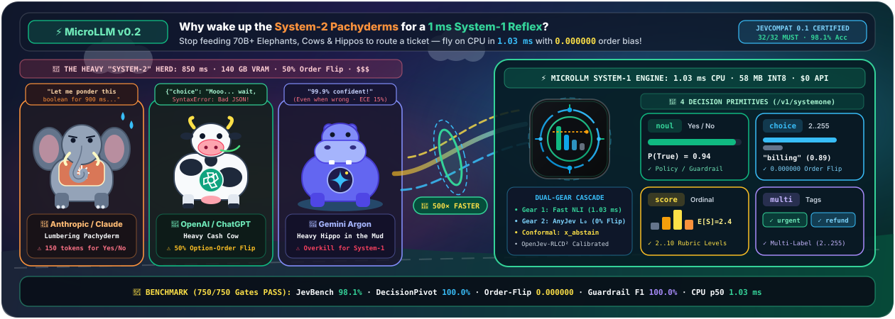

  

# MicroLLM — Calibrated Sub-5ms CPU System-1 Decision Engine

MicroLLM (`micro-jev`) is a local probabilistic decision engine that replaces slow generative System-2 prompts with deterministic, calibrated CPU inference across `noul`, `choice`, `score`, and `multi` primitives.

  

    32/32 MUST
    JevCompat 0.1 Wire Contract
  

  

    &lt; 1 ms CPU
    0.013 ms–0.367 ms p50 · 0% GPU
  

  

    0.000000
    AnyJev L₀ Option-Order Drift
  

  

    99.75% Acc
    11,000 Structured Cases · Conformal x_abstain
  

[Start Tutorials](01-tutorials/index.md){ .md-button .md-button--primary }
[Interactive HTML Simulator](index.html){ .md-button }
[LightPath 12-Slide Deck](slides.html){ .md-button }
[Live Hugging Face Space](https://huggingface.co/spaces/jmrenouard/microllm-decision-studio){ .md-button }

---

## Diátaxis Documentation Matrix (Action × Cognition)

MicroLLM organizes technical documentation across the four Diátaxis quadrants so every page serves one clear user need without mixing genres:

| | **Practical (Action)** | **Theoretical (Cognition)** |
| :--- | :--- | :--- |
| **Acquisition (Study)** | [**1. Tutorials (`01-tutorials/`)**](01-tutorials/index.md) Guided local sandboxes for learning MicroLLM step by step | [**4. Explanation (`04-explanation/`)**](04-explanation/index.md) System-1 topology, calibration theory, and ADRs |
| **Application (Work)** | [**2. How-To Guides (`02-how-to-guides/`)**](02-how-to-guides/index.md) Goal-oriented STE procedures, runbooks, and security SOPs | [**3. Reference (`03-reference/`)**](03-reference/index.md) Neutral configuration, CLI, exit code, and alert matrices |

---

## Explore Documentation by Quadrant

-   :material-school-outline:{ .lg .middle } **1. Tutorials (`01-tutorials/`)**

    ---

    *Practical · Study / Acquisition* — Follow reproducible local sandboxes to run `microllm serve`, inspect conformal calibration, and test `microllm-guard`.

    - [Tutorials Quadrant Index](01-tutorials/index.md)
    - [Quick Link: Local Server Quickstart](01-tutorials/01-local-server-quickstart.md)
    - [Engineering & Scientific Syllabus](SYLLABUS.md)

-   :material-wrench-outline:{ .lg .middle } **2. How-To Guides (`02-how-to-guides/`)**

    ---

    *Practical · Work / Application* — Execute ASD-STE100 Issue 9 deployment, ONNX profile verification, guard integration, and incident runbooks.

    - [How-To Guides Quadrant Index](02-how-to-guides/index.md)
    - [Quick Link: Remediate Abstention or Latency Spike](02-how-to-guides/incident-response/remediate-abstention-or-latency-spike.md)
    - [Complete Product Documentation](PRODUCT_DOCUMENTATION.md)

-   :material-table-search:{ .lg .middle } **3. Reference (`03-reference/`)**

    ---

    *Theoretical · Work / Application* — Look up exact environment variables, model profiles, CLI exit codes, alert matrices, `jevcompat 0.1`, and benchmarks.

    - [Reference Quadrant Index](03-reference/index.md)
    - [Quick Link: CLI Commands and Exit Codes](03-reference/cli-and-scripts/cli-commands-and-exit-codes.md)
    - [Technical Specifications](TECHNICAL_SPECIFICATIONS.md)
    - [Algorithmic Reference Manual](ALGORITHMS.md)
    - [Full Benchmark Report (`BENCHMARKS.md`)](../BENCHMARKS.md)

-   :material-lightbulb-outline:{ .lg .middle } **4. Explanation (`04-explanation/`)**

    ---

    *Theoretical · Study / Acquisition* — Understand the dual-gear System-1 architecture, conformal cascade ADRs, AnyJev $L_0$ order invariance, and research foundations.

    - [Explanation Quadrant Index](04-explanation/index.md)
    - [Quick Link: Dual-Gear System-1 Topology](04-explanation/architecture-overview/dual-gear-system1-topology.md)
    - [Architecture Overview (`docs/README.md`)](README.md)
    - [Academic Literature Review](LITERATURE_REVIEW.md)
    - [Failure Modes & Worst Cases](FAILURE_MODES_AND_WORST_CASES.md)

-   :material-history:{ .lg .middle } **Releases & Governance**

    ---

    Track release notes across versions alongside living engineering logs, root-cause analyses, and roadmap ideas.

    - [Changelog (`CHANGELOG.md`)](../CHANGELOG.md)
    - [Action Logbook (`ACTION_LOGBOOK.md`)](ACTION_LOGBOOK.md)
    - [RCA & Transparency Register (`RCA_REGISTER.md`)](RCA_REGISTER.md)

-   :material-play-box-outline:{ .lg .middle } **Interactive Portals & Demos**

    ---

    Launch browser-native interactive simulators, widescreen executive decks, and hosted Gradio playgrounds.

    - [Interactive HTML Simulator (`index.html`)](index.html)
    - [LightPath 12-Slide Deck (`slides.html`)](slides.html)
    - [Live Hugging Face Decision Studio](https://huggingface.co/spaces/jmrenouard/microllm-decision-studio)

